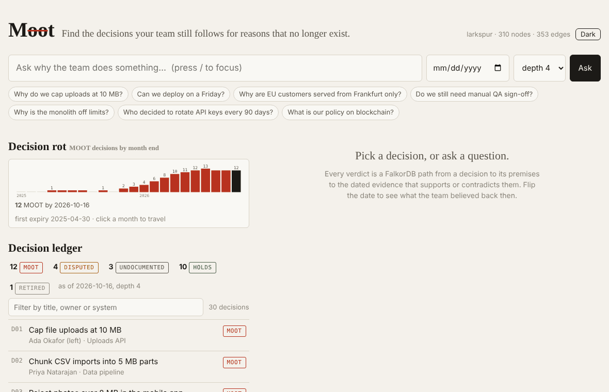
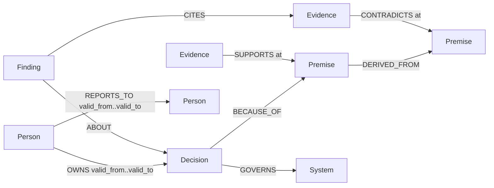

# Moot

**Find the decisions your team still follows for reasons that no longer exist.**

Moot is a company brain that does not answer "what do we do?" It answers "which of our standing decisions still hold, which rest on a premise that has since stopped being true, and where is the evidence?" Decisions, their premises and dated evidence live in a FalkorDB graph. Verdicts are path queries. The model only narrates, and every citation it writes is checked against the rows.

Built for [Graph Hacks: Context for AI Agents](https://www.wemakedevs.org/hackathons/falkordb) (WeMakeDevs x FalkorDB, Oct 2026). Track: **Company Brain**.



## Submission checklist

- [x] FalkorDB is the primary database and the product stops working without it: every verdict is a `ro_query` path query ([graph model](#graph-model), [queries](#the-queries-moot-depends-on))
- [x] Data is synthetic: a fictional 30-person company, Larkspur, with 30 decisions and 208 documents ([data/corpus](data/corpus)); plus 25 real public ADRs checked against GitHub and OSV ([real-world proof](#real-world-proof-public-adrs)), and a backtest on 722 real decisions from 30 public repositories, graded by their own maintainers ([backtest](#backtest-does-it-work-on-real-history))
- [x] README has setup steps and the graph data model
- [x] README lists the Cypher queries and graph algorithms the product depends on
- [ ] Demo video (link below when recorded)
- [ ] Live deployment (link below), full local setup is in [Run it](#run-it)
- [x] AI use disclosed ([below](#ai-disclosure))

## What a judge sees in 40 seconds

1. Ask **"Why do we cap uploads at 10 MB?"** Moot answers **MOOT**: the decision rests on "all uploads pass through the API gateway", which rests on "the gateway enforces a 10 MB body limit", which PR-412 contradicted on 2026-03-02 when the limit went to 100 MB. The owner, Ada, left in May. Two more decisions rest on the same dead premise.
2. Flip **depth 1 → 4**. At depth 1 the verdict is HOLDS, because the direct premise is intact. At depth 2 the chain reaches the dead premise. A doc-chat brain stops at depth 1.
3. Set **as of 2025-06-01**. The same question now answers HOLDS, because the contradicting PR does not exist yet.
4. Ask **"Why do we use Postgres for everything?"** → **UNDOCUMENTED**: the ADR states no premise, so there is nothing to check. Ask "why is the sky blue" → **not in the graph**.
5. Click **Approve: re-open** (or **Record this verdict** on a decision that holds). Only now does Moot write: a `Finding` node with the verdict, the date and the evidence it cites. Ask again and the outcome is *answered from memory*.
6. Look at the **Decision rot** chart: the ledger re-run at every month end. Larkspur went from 0 to 12 MOOT decisions in 22 months without anyone changing an ADR. Click a month to travel there.
7. Open the **Graph** tab for the path drawn from the rows, and the **Cypher** tab for the exact read-only queries FalkorDB ran for that answer, with row counts and milliseconds. That tab is the proof that the database, not the model, decided.
8. Click **Orphaned decisions**. Ada left in May and Lena left last week; four live decisions have no owner. Each one is routed up the reporting line *as it stood on the day the owner left*: Lena reported to Ada, who had already gone, so her decisions climb one more level to Kwame. The reasons and verdict travel with each decision. **Hand to Kwame** writes a new dated `OWNS` edge; the old one stays, so time travel still shows who owned it then.
9. Open a MOOT decision. Instead of a ticket, Moot drafts a **re-open memo**: which reason broke, the dated evidence that broke it, which other decisions rest on the same reason, and who should own the follow-up (the current owner, or the handover successor if they left). **Approve** writes a `Finding` with the memo, the cited evidence and an `ASSIGNED_TO` edge. Nothing happens before that click.
10. Ask **"What if we no longer need SOC 2?"** Moot pretends that reason broke today and shows the three decisions that would fall, HOLDS → MOOT, each with the chain from the decision through the premise that derives from it. **Riskiest reasons** ranks every reason by how many standing decisions sit below it; the $20k tooling budget carries three. Ask "what if churn goes above 5%?" and Moot says no reason in the graph mentions it.
11. Every decision shows an **Agent gate**: may an agent act on it? `GET /api/gate/D01` (or the MCP tool `check_action`) answers **DENY** with the path to PR-412, even though D01 is HOLDS at depth 1, because the gate always audits at full depth. D12 is **ALLOW**, with the dated evidence for every premise. D06 *holds* but the gate says **REVALIDATE**: one reason below it ("we need SOC 2 to sell to enterprise") has no evidence either way, and no evidence is not "holds". D17 is **REVALIDATE** too (contradicted, then re-affirmed: the owner has to rule). An owner's ruling (`POST /api/ruling`, after approval) is a dated edge; the next audit cites it and the gate stops asking until newer evidence lands. Set the date to 2025-06-01 and D07 goes from DENY to REVALIDATE: PR-350 does not exist yet, and nothing had checked its reason. Every gate answer carries a snapshot (`graph`, `as_of`, a digest of every row that can move it), and `GET /api/packet/D01?format=md` downloads the whole case for a reviewer. On the real public ADRs, an agent about to follow log4brains' "Use Lunr" gets DENY: Lunr's last commit was 2020-08-19.

## Run it

Local, no Docker (FalkorDB embedded via `falkordblite`):

```bash
git clone https://github.com/danielAsaboro/moot && cd moot
pip install -e ".[dev]"
make db        # starts FalkorDB on :6379 from the falkordblite package
make seed      # idempotent MERGE of data/graph.json into the "larkspur" graph
make ui        # builds the Next.js UI to frontend/out (needs Node 20+)
make serve     # http://localhost:8000: landing page at /, Ask at /app/, the ledger at /app/ledger/
```

The UI is a Next.js app in `frontend/`, exported as static files that FastAPI serves, so there is still one server at runtime. Without `make ui`, `/` serves the previous plain-JS UI, which also stays at `/legacy`. To work on the UI with hot reload, run `make serve` and `make ui-dev` side by side and open http://localhost:3000.

Docker (FalkorDB server + Moot; the image builds the UI in a Node stage):

```bash
docker compose up --build     # app on :8000, FalkorDB Browser on :3000
```

Optional: `ANTHROPIC_API_KEY` in `.env` turns on model narration, LLM extraction and the end-to-end eval. Verdicts never need it.

CLI:

```bash
moot ledger                              # every decision with its verdict, MOOT first
moot ask "why do we freeze deploys on fridays"
moot ask "why do we cap uploads" --depth 1 --as-of 2025-06-01
moot audit D01                           # the raw rows
moot packet D01                          # the evidence packet behind one verdict, as Markdown
moot verify                              # every headline number in this README checked against the eval JSON; non-zero on drift
moot mcp                                 # MCP server on stdio (Claude Desktop, Claude Code, Cursor)
```

MCP config for Claude Desktop or Claude Code:

```json
{"mcpServers": {"moot": {"command": "python3", "args": ["-m", "moot.cli", "mcp"], "cwd": "/path/to/moot"}}}
```

## Graph model

One named graph per company (`select_graph(tenant)`). Nodes:

| Label | Key properties | Meaning |
|---|---|---|
| `Decision` | id, title, summary, decided_on, source | a standing decision (one per ADR) |
| `Premise` | id, text, kind (fact / constraint / assumption / unwritten), unchecked | a reason behind one or more decisions; `unchecked` says why nobody could check it |
| `Evidence` | id, kind (adr / pr / ticket / chat / doc), title, date, excerpt | a dated document |
| `Person` | id, name, role, joined, left | people, with tenure |
| `System` | id, name | what a decision governs |
| `Finding` | id, verdict, kind (verdict / reopen / ruling), as_of, depth, created_at, note, digest | Moot's own memory: an approved verdict, re-open memo or owner ruling; `digest` is the decision's snapshot when it was written |

Edges:

```
(Decision)-[:BECAUSE_OF {quote}]->(Premise)          the stated reason
(Premise)-[:DERIVED_FROM]->(Premise)                 a premise that only holds while another does
(Evidence)-[:SUPPORTS {at, stated?, quote}]->(Premise)   dated affirmation: `at` when it took effect, `stated` when it was said (defaults to `at`)
(Evidence)-[:CONTRADICTS {at, quote}]->(Premise)     dated contradiction
(Decision)-[:RECORDED_IN]->(Evidence)                the ADR itself
(Person)-[:OWNS {valid_from, valid_to, handed_over_from}]->(Decision)  ownership with a validity window; a handover adds a newer edge
(Person)-[:REPORTS_TO {valid_from, valid_to}]->(Person)  the reporting line, dated
(Person)-[:AUTHORED]->(Evidence)
(Decision)-[:GOVERNS]->(System)
(Decision)-[:SUPERSEDES {at}]->(Decision)           dated by the superseding decision
(Evidence)-[:RETIRES {at, quote}]->(Decision)        the document that retired a decision whose successor is not in the graph
(Finding)-[:ABOUT]->(Decision), (Finding)-[:CITES]->(Evidence), (Finding)-[:SUPERSEDED_BY]->(Finding)
(Finding)-[:ASSIGNED_TO]->(Person)                   who owns the follow-up of a re-open memo
(Finding)-[:SUPPORTS|CONTRADICTS {at, quote}]->(Premise), (Finding)-[:RULES_ON]->(Decision)   an owner's ruling, read by the next audit like any evidence
```



Indexes: range index on `id` for every label; full-text on `Decision(title, summary)`, `Premise(text)` and `Evidence(title, excerpt)` for entity resolution.

Verdict rules (pure Python in `moot/verdict.py`, applied to the rows the queries return):

- an event counts on an as-of date once it had both taken effect (`at`) and been stated (`stated`): valid at T, as known at K. Events are ordered by `at`, then `stated`
- a premise is **expired** when its latest event is a CONTRADICTS; **disputed** when it was contradicted and later re-affirmed; **unchecked** when it carries no evidence and is marked as a check nobody could answer; **unevidenced** when it carries no evidence at all (nobody checked it, so "nothing contradicts it" is not "holds"); **holds** when it has dated support and no standing contradiction
- an **owner's ruling** settles everything before it: only the ruling and later events count, so newer evidence reopens the question by the same rules
- a decision is **RETIRED** if a `SUPERSEDES` or `RETIRES` edge dated on or before as-of points at it; **UNDOCUMENTED** if it has no premise; **MOOT** if any premise within `depth` hops is expired; **DISPUTED** if any is disputed; **HOLDS** otherwise
- the **agent gate** (`gate()`) turns a full-depth audit into an action decision: **DENY** if the decision is not in the graph, not decided yet, retired, or rests on an expired premise; **REVALIDATE** if the graph cannot vouch for it (no premise, a disputed, unchecked or unevidenced premise, an owner who left, or a graph with no dated evidence at all); **ALLOW** otherwise, with the supporting evidence as its basis. A graph with no decisions answers DENY with `graph_empty`: an empty read is never a negative

## The queries Moot depends on

The model never writes Cypher. These parameterised queries are the whole tool catalogue (`moot/tools.py`), exposed to the agent, the API and the MCP server.

**1. Entity resolution** (full-text index; the question's content words, OR-ed, prefix-matched)

```cypher
CALL db.idx.fulltext.queryNodes('Decision', $q) YIELD node, score
RETURN node.id, node.title, node.summary, node.decided_on, score ORDER BY score DESC LIMIT $limit
```

**2. The audit**: premises up to `depth` hops, with every dated event on each premise and the person who wrote it. This is the verdict.

```cypher
MATCH (d:Decision {id: $id})
MATCH p = (d)-[:BECAUSE_OF|DERIVED_FROM*1..4]->(pr:Premise)
OPTIONAL MATCH (e)-[r:SUPPORTS|CONTRADICTS]->(pr)          // Evidence, or an owner's ruling (Finding)
  WHERE r.at <= $as_of AND coalesce(r.stated, r.at) <= $as_of  // took effect and was stated by as_of
OPTIONAL MATCH (a:Person)-[:AUTHORED]->(e)
RETURN pr, nodes(p) AS pn, length(p) AS hops,
       collect({id: e.id, title: e.title, kind: e.kind, rel: type(r), at: r.at, stated: r.stated, quote: r.quote, author: a.name})
ORDER BY hops
```

Retirement is read in the same pass and is dated too, so time travel cannot retire a decision with a successor that does not exist yet:

```cypher
MATCH (d:Decision {id: $id})
OPTIONAL MATCH (n:Decision)-[su:SUPERSEDES]->(d) WHERE su.at <= $as_of
OPTIONAL MATCH (x:Evidence)-[rt:RETIRES]->(d) WHERE rt.at <= $as_of
RETURN d, n.id, n.title, su.at, x.id, x.title, rt.at, rt.quote
```

`nodes(p)` is returned with every answer and drawn in the UI as the path chain. `$as_of` makes the same question answer differently on different dates.

**2b. The agent gate**: query 2 (and the retirement read) at depth 6, then `gate()`. It returns `ALLOW | DENY | REVALIDATE`, the reasons with the premise, the evidence id and `nodes(p)` for each, and for ALLOW the supporting evidence. It never writes. Exposed as `GET /api/gate/{id}` (`?graph=public_adrs` for the real ADRs) and the MCP tool `check_action`, described to clients as "call before you enforce, rely on or renew a decision; only act on ALLOW". Each answer carries `snapshot: {graph, as_of, digest}`; the digest covers every row that can change this decision's gate on any date (premises to depth 6, every dated event, retirement, owners), so the same pair always gives the same verdict and a new digest means re-check. `tests/test_graph.py::test_api_mcp_and_tools_agree_at_the_boundary` asks the HTTP route, the MCP tool and the function the same question on the day before PR-412, the day itself and the day after, and requires byte-identical answers: the as-of cutoff is inclusive.

Read-only is enforced by the engine: every read is `GRAPH.RO_QUERY`, which FalkorDB refuses to run a write through. There is no keyword filter to get wrong.

**3. Shared-premise impact** with PageRank over the whole dependency graph, so expired premises rank by what depends on them:

```cypher
MATCH (pr:Premise {id: $id})
MATCH p = (d:Decision)-[:BECAUSE_OF|DERIVED_FROM*1..6]->(pr)
OPTIONAL MATCH (d)-[:GOVERNS]->(s:System)
RETURN DISTINCT d.id, d.title, length(p), collect(DISTINCT s.name)
```
```cypher
CALL algo.pageRank(null, null) YIELD node, score WHERE node:Premise RETURN node.id, score
```

**4. Trace a new document** to every decision it can reach (`algo.SPpaths`): "what did this PR just break in our rulebook?"

```cypher
MATCH (e:Evidence {id: $id}), (d:Decision)
CALL algo.SPpaths({sourceNode: e, targetNode: d,
     relTypes: ['CONTRADICTS','SUPPORTS','BECAUSE_OF','DERIVED_FROM'], relDirection: 'both', maxLen: 6, pathCount: 1})
YIELD path RETURN d.id, d.title, length(path), nodes(path)
```

**5. Ownership as of a date** (validity windows on the edge; the latest edge that had started by `$as_of` wins, so a handover never erases history):

```cypher
MATCH (p:Person)-[o:OWNS]->(d:Decision) WHERE o.valid_from <= $as_of AND ($id IS NULL OR d.id = $id)
RETURN d.id, p.id, p.name, p.role, o.valid_from, o.valid_to, o.handed_over_from ORDER BY d.id, o.valid_from
```

**6. The ledger**, one pass for every decision:

```cypher
MATCH (d:Decision)
OPTIONAL MATCH (n:Decision)-[su:SUPERSEDES]->(d) WHERE su.at <= $as_of
OPTIONAL MATCH (x:Evidence)-[rt:RETIRES]->(d) WHERE rt.at <= $as_of
WITH d, coalesce(n.id, x.id) AS sup
OPTIONAL MATCH p = (d)-[:BECAUSE_OF|DERIVED_FROM*1..4]->(pr:Premise)
OPTIONAL MATCH (e:Evidence)-[r:SUPPORTS|CONTRADICTS]->(pr) WHERE r.at <= $as_of
WITH d, sup, pr, collect({rel: type(r), at: r.at}) AS ev
OPTIONAL MATCH (d)-[:GOVERNS]->(s:System)
RETURN d, sup, pr.id, ev, collect(DISTINCT s.name) ORDER BY d.id
```

**7. Orphaned decisions → successor.** For every live decision whose owner of record has left, walk `REPORTS_TO` using the edges that were valid on the day the owner left, and stop at the first person who is still here. A manager who also left is skipped, not chosen.

```cypher
MATCH (o:Person {id: $pid}) MATCH path = (o)-[:REPORTS_TO*1..5]->(m:Person)
WHERE all(r IN relationships(path) WHERE r.valid_from <= $left_on AND (r.valid_to = '' OR r.valid_to > $left_on))
  AND (m.left = '' OR m.left > $as_of)
RETURN m.id, m.name, m.role, [n IN nodes(path) | {id: n.id, name: n.name, left: n.left}], length(path)
ORDER BY length(path) LIMIT 1
```

**8. The re-open memo** is assembled from queries 2, 3 and 7: the expired premise and its contradicting evidence (2), every other decision on the same premise (3), the suggested owner (5, then 7 if the owner left). The text is a template over those rows; the server rebuilds it on approval, so a client cannot record a memo the graph does not support.

**9. What if a reason broke today?** Every decision that rests on the premise, directly or through derived premises, with the chain. Any of them that is not already MOOT or RETIRED would flip to MOOT.

```cypher
MATCH (pr:Premise {id: $id})
MATCH p = (d:Decision)-[:BECAUSE_OF|DERIVED_FROM*1..4]->(pr)
RETURN d.id, d.title, nodes(p), length(p) ORDER BY length(p)
```

Free-text "what if" questions resolve to a premise with the `Premise(text)` full-text index; on a tie the broader reason (more decisions below it) wins. No match means "no reason in the graph mentions that".

**10. Riskiest reasons**: every premise with the decisions below it and its own dated events, ranked by how many *standing* (not yet MOOT, not RETIRED) decisions would fall with it.

```cypher
MATCH (pr:Premise) OPTIONAL MATCH (d:Decision)-[:BECAUSE_OF|DERIVED_FROM*1..4]->(pr)
OPTIONAL MATCH (e:Evidence)-[r:SUPPORTS|CONTRADICTS]->(pr) WHERE r.at <= $as_of
RETURN pr.id, pr.text, pr.kind, collect(DISTINCT d.id), collect(DISTINCT {rel: type(r), at: r.at})
```

We compared this count with `algo.pageRank` over the whole graph. PageRank ranks differently (the SOC 2 rotation premise is 3rd by count and 10th by PageRank) because evidence edges pour score into whichever premises are most discussed, not the ones most depended on. The count is the question a leader asks, and it explains itself, so the ranking uses the count; PageRank stays in the API (`pagerank_rank`) for comparison.

**The writes**, each behind an approval button. A handover is one `CREATE (p)-[:OWNS {valid_from: $as_of, valid_to: '', handed_over_from: $prev}]->(d)`. A verdict or re-open memo is a `Finding` that supersedes the previous finding for the decision and cites the evidence it relied on. An owner's ruling is a `Finding` with a dated `SUPPORTS` or `CONTRADICTS` edge to the premise; it is refused for a premise outside the decision or one that already has evidence that decides it.

```cypher
MATCH (d:Decision {id: $did})
OPTIONAL MATCH (prev:Finding)-[:ABOUT]->(d) WHERE NOT (prev)-[:SUPERSEDED_BY]->()
WITH d, collect(prev) AS prevs
CREATE (f:Finding {id: $fid, verdict: $verdict, as_of: $as_of, depth: $depth, created_at: $now})-[:ABOUT]->(d)
...  (prev)-[:SUPERSEDED_BY]->(f), (f)-[:CITES]->(e)
```

Also used: `algo.WCC` in tests and exploration to cluster decisions that share premises, and `db.idx.fulltext.createNodeIndex` for the indexes above.

## Architecture

```
corpus (ADRs, PRs, tickets, chat, docs)
   │  moot extract  (model proposes; every quote must be a substring of its document, or it is dropped)
   ▼
truth.json / extracted.json ──► graph.json ──► moot seed (MERGE, idempotent) ──► FalkorDB, one graph per company
                                                                                   │
            ┌──────── read-only parameterised Cypher tools (ro_query) ─────────────┘
            ▼
   verdict.py (pure: verdict + agent gate)  ──►  agent.py: resolve → audit → memory check → narrate → validate citations
                                                  (UNDOCUMENTED / RETIRED / NOT_YET: no model call at all)
            │                       │
      FastAPI + web UI        MCP server (stdio)      moot CLI
            │
   Approve ──► write_finding (verdict or re-open memo) · handover (new dated OWNS edge)
```

Four outcomes, as the organisers' reference architecture asks: `answered_with_path`, `answered_from_memory`, `not_in_graph`, `unknown_entity`.

## Backtest: does it work on real history?

Every other result in this README is graded against an answer key we wrote, or has none. This one is graded by strangers. `make backtest` reads the git history of the ADR folders of **30 public repositories** (GOV.UK, Ministry of Justice, Open edX, Mozilla FxA, Backstage, Home Assistant, Kyma and others), and takes the maintainers' own commits as the answer key: a decision dies on the day its repository marked it superseded, deprecated or invalidated, archived it, or wrote a later ADR dropping the tool it picked. Then it rewinds each repository month by month, gives Moot only the evidence that existed that month (the tool's own commit history and dated license changes), and asks the agent gate the same question an agent would: may I act on this? The key never enters the graph, and was fixed before the gate ran. Full results, every death and every flag: [eval/results_backtest.md](eval/results_backtest.md).

**Coverage, the finding that matters most.** 722 real decisions were in force at some point; 23 were later abandoned by their own repository. Only 97 (13%) pick an outside tool, and only **6 of the 23 deaths** are among them. Outside evidence can speak to about a quarter of the decisions real teams abandon. The rest die for internal reasons: a reorganisation, a project winding down, a developer preferring something else. Only a company's own documents can catch those, which is the case for the company graph above.

| on the 97 tool decisions (6,013 decision-months) | caught before maintainers | missed | flagged while still listed in force |
|---|---|---|---|
| **Moot gate** | **2 / 6** (recall 0.33, bootstrap 95% CI 0.00–0.80, Wilson 0.10–0.70) | 4 | 22 |
| trust the ADR | 0 / 6 | 6 | 0 |
| age ≥ 3 years | 3 / 6 | 3 | 73 |
| random, same number of flags | 1.4 / 6 | 4.6 | 22.6 |

Six deaths is too few to rank anything on recall, and we say so. Moot's two catches were license changes: GOV.UK combined its Mongo clusters in 2017, MongoDB went SSPL in October 2018, and GOV.UK replaced Mongo with DocumentDB a year later; Moot said DENY 350 days before the repository did. Its four misses were three internal decisions and one outside fact it does not read (Meta stopped recommending Create React App while CRA's repository still had commits). The 22 flags on decisions still listed as in force cannot be graded by the key, so we read each one: **15** rest on a premise that really died upstream and nobody revisited (Terraform's BSL, Lunr with no commit since 2020, Kubeless archived), **4** were later abandoned in another document without retiring the ADR (FxA moved from Intern to Playwright; MoJ moved from Elasticsearch to OpenSearch), **1** is mixed, and **2** are false alarms (a managed AWS Redis is not bound by Redis's license). The age rule raises 73 flags with no reason attached; every Moot flag names a dated fact a reviewer can check in a minute.

`make backtest` re-runs everything from GitHub (about 1.5 GB of blob-less clones). `make backtest-score` re-scores the committed snapshot in `data/backtest/` offline. The live checker's vulnerability premise is left out of the backtest: OSV dates an advisory, but not which release a team was on at a past date.

## Evaluation

Every study is listed in [docs/studies.md](docs/studies.md) with its hypothesis written before it ran, and results we have withdrawn stay there, marked, with the reason. `moot verify` checks every number in this section against the JSON the evals wrote (`moot verify --rerun` first re-runs them from committed inputs) and exits non-zero on any mismatch.

`make eval` reproduces [eval/results.md](eval/results.md) with no model: for the 16 decisions that have an invalidating document, does the method surface it?

| method | recall@5 of invalidating docs | decisions with ≥1 found |
|---|---|---|
| graph path query (Moot) | **1.00** (consistency check, see below) | **100%** |
| BM25 top-5, query = decision title + summary | 0.81 | 81% |
| random 5 docs (control) | 0.01 | – |

**The 1.00 is not a retrieval result.** The targets are the CONTRADICTS edges in `truth.json`, and the graph's CONTRADICTS edges are built from the same spec, so the graph reads back its own edges. It says the ingest kept them all. The BM25 row is the real finding: the document that kills a decision's reason is often unreachable by similarity to the decision.

`make eval-scale` reproduces [eval/results_scale.md](eval/results_scale.md), also with no model. It pads the corpus with up to 20,000 extra documents about the same systems, seeds a graph for each size, and measures FalkorDB latency; then it scores verdicts against the ground truth and against a retrieval-only staleness heuristic. Warm numbers are nearest-rank p50 / p95 over n calls after warmup; *cold* is the first call on a freshly seeded graph, reported apart. Raw samples are in `eval/results_scale.json`.

| extra noise docs | audit warm n · p50 / p95 | audit cold | full ledger warm n · p50 / p95 | seed |
|---|---|---|---|---|
| 0 | 80 · 1.0 / 1.1 ms | 2.8 ms | 20 · 2.8 / 2.9 ms | 0.0 s |
| 1,000 | 80 · 0.9 / 1.1 ms | 2.4 ms | 20 · 2.7 / 3.1 ms | 0.0 s |
| 5,000 | 80 · 0.9 / 1.1 ms | 3.2 ms | 20 · 2.8 / 3.0 ms | 0.2 s |
| 20,000 | 80 · 0.9 / 1.1 ms | 4.5 ms | 20 · 2.9 / 3.0 ms | 0.6 s |

| verdicts (30 decisions) | exact | stale precision | stale recall | F1 |
|---|---|---|---|---|
| graph path rule (Moot) | **30/30** | **1.00** | **1.00** | **1.00** |
| BM25 top-5 + change-cue heuristic | – | 0.50 | 0.75 | 0.60 |

The audit is an index lookup plus a bounded path expansion, so its latency does not move with corpus size. These are laptop numbers measured with other work running, good for the shape of the curve, not for a production quote. The seed column is where FalkorDB taught us something: the first import matched edge endpoints without labels, which cannot use the per-label index and took three minutes at 20k documents; naming the labels on both ends brought it to under a second on an M-series Mac. The 30/30 shares the common-mode caveat above: the verdict rule and the ingest agree.

`make eval-gate` reproduces [eval/results_gate.md](eval/results_gate.md), no model: would each method let an agent act on a decision it should not? An agent should act only on the 10 decisions that HOLD; the other 20 should be stopped.

| method | false allows (of 20) | 95% upper bound on the false-allow rate | of which stale (of 16) | false blocks (of 10) |
|---|---|---|---|---|
| Moot gate (full-depth audit + `gate()`) | **0** | 0.12 | **0** | 6, all REVALIDATE |
| BM25 top-5 + change-cue heuristic | 4 | 0.38 | 4 | 8 |
| trust the ADR (a doc-chat brain that finds it and stops) | 20 | 1.00 | 16 | 0 |

Zero false allows in 20 is a small sample: the one-sided 95% Wilson bound still allows a true rate up to 12%. The six false blocks are decisions the spec calls HOLDS whose reasons nobody ever checked: one premise below each has no evidence either way. The gate asks to revalidate them instead of allowing, and an owner's ruling settles each with a dated edge. Until 2026-10-18 the gate allowed them and printed "all premises hold"; that result is withdrawn ([docs/studies.md](docs/studies.md#withdrawn-results)).

On the 25 real public ADRs, which have no answer key, the gate denies 7 (5 rest on a reason a GitHub or OSV check contradicts, 2 were retired by their own repository) and asks to revalidate 7 whose vulnerability check could not be answered; 23 of the 25 still say *accepted*. The same answer key built the graph, so the Larkspur zeros show the gate and verdict rules agree, not that extraction is solved.

`python3 eval/eval_ablation.py` reproduces [eval/results_ablation.md](eval/results_ablation.md), pre-registered before its first run: does the graph carry the gate's answer, or would the rule text decide it anyway? It deletes random edges, and also adds random junk contradictions (the direction a deletion-only control cannot see), 20 seeds per level.

| arm | at 0% | at 100% (or 2× junk) |
|---|---|---|
| delete every CONTRADICTS edge: false allows, legacy rule (no evidence = holds) | 0 of 20 | 12 of 20 |
| delete every CONTRADICTS edge: false allows, current gate | 0 of 20 | 2 of 20 |
| add 28 random CONTRADICTS edges: holds decisions denied | 0 of 10 | 5.65 of 10 |

Deleting the evidence that killed a decision makes the legacy rule wave it through; the current gate turns the missing evidence into REVALIDATE instead. Junk contradictions get followed too: the gate cannot tell a plausible wrong edge from a real one, which is why every DENY names the evidence id for a human to check. One of the four predictions failed (deleting reason edges never raised false allows, because every stale Larkspur decision states exactly one premise), and the file says so.

`make eval-e2e` (needs a key) runs the model-in-the-loop comparison: a BM25 RAG company brain asked "does this still hold?" against Moot's graph verdict. The headline column is how many of the 16 decisions whose premise was contradicted each system still calls HOLDS, i.e. treats the dead premise as current; it also scores verdict accuracy and whether the cited document is the true invalidating one. Results land in `eval/results_e2e.md`.

## Real-world proof: public ADRs

Larkspur is invented. To show the engine works on real text, Moot also audits **25 real architecture decision records from 5 public GitHub repositories** ([ministryofjustice/cloud-platform](https://github.com/ministryofjustice/cloud-platform), [alphagov/govuk-infrastructure](https://github.com/alphagov/govuk-infrastructure), [alphagov/govuk-aws](https://github.com/alphagov/govuk-aws), [backstage/backstage](https://github.com/backstage/backstage), [thomvaill/log4brains](https://github.com/thomvaill/log4brains)), each of which picks a named open-source tool. It lives in its own named graph, `public_adrs`, next to the demo tenant; the verdicts come from the same path queries.

We read 144 ADRs from those repositories first. Most of their stated reasons are internal ("Jenkins took a week a month to keep alive") and cannot be checked from outside. What every tool choice does rest on, without saying so, is that the tool stays maintained, stays open source and stays free of known vulnerabilities. Those are the premises Moot checks, each as a dated `Evidence` node:

| check | source | contradicts the premise when |
|---|---|---|
| maintained | GitHub API | the repository is archived, or its default branch has no commit in the last 365 days |
| open source | GitHub license, then the LICENSE text | the only licenses offered are source-available (BUSL, SSPL, Elastic, RSAL) |
| no known vulnerability | [OSV.dev](https://osv.dev) | an advisory affects the tool's latest published version |

Snapshot of 2026-10-17 (`data/realworld/checks.json`, reproduced by `make realworld`): 26 tools, **71 checks answered, 6 failed, 7 could not be answered** and are listed as unchecked instead of guessed (three tools have no package in an OSV ecosystem; for four Go projects the module proxy's "latest" did not match the project's own latest release, so the vulnerability check refuses to answer). An unanswered check is still a `Premise` node, marked `unchecked` and carrying no evidence: the verdict does not move, but the audit reports it as unchecked rather than holding, and the agent gate says REVALIDATE. Every record's quote is verified against the ADR fetched from GitHub; a record whose quote is missing is dropped.

Two records have since been retired by their own repositories, and the graph says so with a dated `RETIRES` edge whose quote is verified against the retiring file: Backstage ADR013 (node-fetch) was superseded by ADR014 on 2024-11-29, and GOV.UK ADR 0007 (Fluent Bit and Elasticsearch) was marked "Deprecated (no superseding ADR)" on 2025-07-21. From those dates both are RETIRED, so node-fetch's failing maintenance check no longer counts against a decision that is not in force. Before them, time travel shows them as they were.

The five records that are still in force and rest on a reason that no longer holds (MOOT):

| ADR | decided | unwritten reason that no longer holds |
|---|---|---|
| log4brains: Use Lunr for search | 2020-11-03 | Lunr.js is maintained: last commit 2020-08-19 |
| GOV.UK AWS: Puppet architecture | 2017-07-04 | Puppet is maintained: last commit to puppetlabs/puppet main 2024-12-11 |
| GOV.UK: Prometheus Adapter for HPA metrics | 2025-06-03 | Prometheus Adapter is maintained: last commit 2025-04-01, two months before the ADR |
| GOV.UK: Use Crossplane | 2025-10-20 | latest Crossplane (v2.4.2) has no known vulnerability: 1 OSV advisory |
| MoJ: Use Kubernetes | 2018-04-10 | latest Kubernetes (v1.37.1) has no known vulnerability: 2 unfixed OSV advisories on `k8s.io/kubernetes` |

The licence checks all held: Elasticsearch and Redis both moved to source-available licences, and both now also offer AGPL, so "open source" still holds for them. Concourse CI was chosen by the Ministry of Justice in 2018 and by GOV.UK in 2025; in the graph that is one premise carrying two organisations' decisions. Limits: "no commit in a year" is a proxy for maintenance, not a verdict on quality; OSV advisories on the Kubernetes monorepo module include issues that are mitigated by configuration rather than fixed; and this is 25 records, not a survey.

## Honest limits

- The corpus is synthetic. Larkspur, its people and its documents are invented. The 30 ADRs carry hand-written context, alternatives and consequences (`moot/corpus/prose.py`); PR bodies and chat threads are dressed from the same spec; the 150 background noise documents are templated from a seed. The committed `graph.json` is built from the ground-truth spec, not from the LLM extractor. `moot extract` runs the extractor over the same text so the two can be compared, and its span check drops any premise or relation whose quote is not literally in the source.
- A premise can expire without any document saying so. Moot only knows what was written down. The backtest shows the size of this: three in four real decisions that teams abandoned picked no outside tool, so no outside check could have seen them die.
- Extraction misses premises that are implied rather than stated. Verdicts are only as good as the BECAUSE_OF edges.
- "Disputed" is a coarse rule (contradicted, then re-affirmed). It does not weigh evidence quality.
- BM25 is a fair but not state-of-the-art retrieval baseline; it was chosen so the eval reproduces without an embedding model.
- Reporting lines are taken as recorded. Moot routes an orphaned decision up the line as it stood when the owner left; if HR never updated the line (Lena still "reports to" Ada), Moot skips people who left rather than guessing a new manager.
- "What if" pretends one reason breaks at a time. It does not model partial breaks ("churn rises a little") or reasons nobody wrote down.
- No evidence is not "holds". A premise nobody ever checked makes the gate say REVALIDATE even when the verdict is HOLDS, which costs six false blocks on Larkspur. We chose that over letting an agent act on an unchecked reason.
- Owner rulings are a mechanism, not a measured improvement. A ruling stops the gate asking the same question again until newer evidence lands, and the graph shows why; we have not measured whether that makes later gate answers better.
- The gate follows the edges it is given. The ablation shows random junk contradictions are followed like real ones; an extractor that writes plausible wrong edges would mislead it the same way.
- Two dates per event (`at`, `stated`) are supported by the queries, but the Larkspur corpus and the real-ADR snapshot carry only one, so nothing in the committed data exercises the difference yet beyond the tests.
- The full-text resolver is keyword-based. A question that shares no words with a decision's title or summary returns "unknown entity" rather than a guess, by design.

## AI disclosure

Built with Claude (Claude Code) as a pair programmer under the author's direction: the graph model, verdict rules, query design and corpus spec were specified by the author; Claude wrote most of the code, the synthetic documents and this README from those specifications, and the author reviewed and tested every piece. The model inside the product (`claude-opus-5-5` by default) narrates and extracts; it never decides a verdict, never writes Cypher and never touches the database. Rulings, findings and handovers are written by fixed queries after a human approves, never by the model.

## License

MIT.
