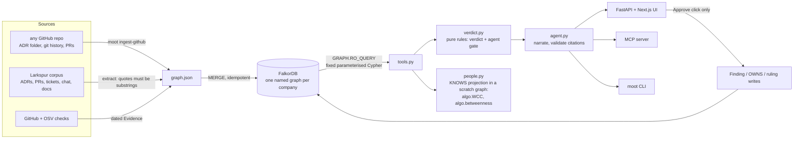
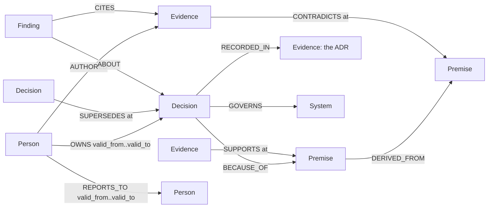

# Moot

**A company brain that finds the decisions your team still follows for reasons that no longer exist, and shows the evidence path.**

[](https://github.com/danielAsaboro/moot/actions/workflows/ci.yml)

[Live app](https://moot.bringaihome.xyz) · [Demo video](https://vimeo.com/1237038749) · [Blog: I built a company brain that refuses to answer questions](https://moot.bringaihome.xyz/i-built-a-company-brain-that-refuses-to-answer-questions/) · Built for [Graph Hacks](https://www.wemakedevs.org/hackathons/falkordb) (WeMakeDevs x FalkorDB), track **Company Brain**


## The story in 40 seconds

Ask **"Why do we cap uploads at 10 MB?"** A doc-chat brain finds the ADR and says: because the gateway rejects bodies over 10 MB. Moot answers **MOOT**:

```
D01 Cap file uploads at 10 MB
 └─BECAUSE_OF→ "All file uploads pass through the API gateway"
                └─DERIVED_FROM→ "The API gateway enforces a 10 MB request body limit"
                                 ←CONTRADICTS─ PR-412, 2026-03-02 "Raise the API gateway body limit to 100 MB"
owner: Ada Okafor, left 2026-05-15 · D02 and D03 rest on the same dead reason
```

- Flip **depth 1 → 4**: at depth 1 the verdict is HOLDS, because the stated reason is intact. The dead reason is two hops down. That hop is what a graph buys you.
- Set **as of 2025-06-01**: HOLDS again, because PR-412 did not exist yet. Every edge is dated.
- Ask an agent's question, **"may I enforce D01?"** (`GET /api/gate/D01`, or the MCP tool `check_action`): **DENY**, with the path to PR-412.
- Ask **since when**: MOOT since 2026-03-02, after HOLDS from 2025-02-10. Moot re-audits on every date something in the decision's graph happened.
- Ask **who knows why**: Marcus Chen, who wrote PR-412, and Ada Okafor, the owner, who left. Bus factor 1. **What leaves with Marcus?** Five live decisions nobody else here can explain, five reasons only he wrote evidence on, and the Uploads API.
- Point it at a real repository: `moot ingest-github alphagov/govuk-infrastructure` reads its ADR folder, git history and pull requests into a new graph and audits every decision against GitHub and OSV. Four repositories are already in the [live app](https://moot.bringaihome.xyz/app/ledger/?graph=gh_alphagov_govuk_infrastructure).

Verdicts are FalkorDB path queries. The model only narrates, every id it cites is checked against the rows, and it never writes Cypher.

## Results

| question | Moot | baseline | source |
|---|---|---|---|
| Larkspur: stale or retired decisions an agent was allowed to act on (of 20) | **0** | BM25 + change cues 4 · trust the ADR 20 | [gate eval](eval/results_gate.md) |
| Larkspur, 90 questions (still holds? why? since when?): dead decisions called HOLDS (of 22) | **0** | RAG + same model 13 · RAG over stated reasons 7 | [head-to-head](eval/results_baseline.md) |
| Real repositories: decisions caught dead before their own maintainers (of 6 tool deaths) | **2** | trust the ADR 0 · random 1.4 | [backtest, 30 public repos](eval/results_backtest.md) |
| Real public ADRs denied with a dated reason (of 25) | **7** | 23 of the 25 still say *accepted* | [real-world audit](docs/evaluation.md#real-world-proof-public-adrs) |
| Audit latency at 20,000 noise documents, p50 | **0.9 ms** | flat from 0 to 20,000 | [scale eval](eval/results_scale.md) |

On the same 90 questions Moot gets 90/90 verdicts and 24/24 "since when" dates exactly; plain RAG with the same local model gets 62/90 and 8/24. The ablations say what carries it: ignoring dates drops Moot to 62/90, removing FalkorDB (same rules over retrieved documents) to 60/90, depth 1 to 88/90. Larkspur's labels share a spec with its graph, so Moot's row is a ceiling, not extraction quality ([threats](eval/results_baseline.md#threats-to-validity-worst-first)).

Every number above is checked by `moot verify` against the JSON the evals wrote (`moot verify --rerun` re-derives it from committed inputs). Studies are registered before they run, withdrawn results stay listed with the reason ([docs/studies.md](docs/studies.md)), and every table is in [docs/evaluation.md](docs/evaluation.md).

## Submission checklist

- [x] FalkorDB is the primary database and the product stops working without it: every verdict is a `ro_query` path query
- [x] Data: a synthetic 30-person company (Larkspur: 30 decisions, 208 documents), 25 real public ADRs checked against GitHub and OSV, a backtest on 722 real decisions from 30 public repositories, and a connector for any public GitHub repository (four ingested: 75 decisions, 59 pull requests)
- [x] Graph data model, key Cypher queries and graph algorithms ([below](#graph-model), [full catalogue](docs/queries.md))
- [x] Setup in one command ([Run it](#run-it))
- [x] Demo video: https://vimeo.com/1237038749
- [x] Live deployment: https://moot.bringaihome.xyz (FalkorDB Cloud)
- [x] AI use disclosed ([below](#ai-disclosure))

## Architecture



The four outcomes the organisers' reference architecture asks for: `answered_with_path`, `answered_from_memory`, `not_in_graph`, `unknown_entity`. Nothing is written to the graph without an approval call.

## Graph model

One named graph per company (`select_graph(tenant)`): `larkspur` (demo), `public_adrs` (real ADRs), `backtest` (30 real repositories), and one `gh_<owner>_<repo>` graph per repository brought in with `moot ingest-github`. All of them are selectable in the UI (the Graph menu), the API (`?graph=`) and MCP (`graph=`).



| Label | Key properties | Meaning |
|---|---|---|
| `Decision` | id, title, summary, decided_on, source | a standing decision (one per ADR) |
| `Premise` | id, text, kind, unchecked | a reason behind one or more decisions |
| `Evidence` | id, kind (adr / pr / ticket / chat / doc / check), title, date, excerpt | a dated document |
| `Person` | id, name, role, joined, left | people, with tenure |
| `System` | id, name | what a decision governs |
| `Finding` | id, verdict, kind (verdict / reopen / ruling), as_of, digest | Moot's own memory, written only after a human approves |

Every event edge (`SUPPORTS`, `CONTRADICTS`, `SUPERSEDES`, `RETIRES`) carries `at`, the date it took effect, and optionally `stated`, the date it became known; ownership and reporting lines carry validity windows. Indexes: a range index on `id` for every label, full-text on `Decision(title, summary)`, `Premise(text)` and `Evidence(title, excerpt)`. The full edge list is in [docs/queries.md](docs/queries.md).

## The queries and algorithms Moot depends on

The model never writes Cypher. These are the core of the fixed catalogue in `moot/tools.py`; the [full catalogue](docs/queries.md) has all of them.

**The audit**: premises up to `depth` hops, with every dated event known by `as_of`. This query is the verdict.

```cypher
MATCH (d:Decision {id: $id})
MATCH p = (d)-[:BECAUSE_OF|DERIVED_FROM*1..4]->(pr:Premise)
OPTIONAL MATCH (e)-[r:SUPPORTS|CONTRADICTS]->(pr)
  WHERE r.at <= $as_of AND coalesce(r.stated, r.at) <= $as_of
OPTIONAL MATCH (a:Person)-[:AUTHORED]->(e)
RETURN pr, nodes(p) AS pn, length(p) AS hops,
       collect({id: e.id, rel: type(r), at: r.at, quote: r.quote, author: a.name})
ORDER BY hops
```

Pure rules in `moot/verdict.py` then decide: a premise is **expired** when its latest event is a contradiction, **disputed** when contradicted then re-affirmed, **unevidenced** when nothing ever checked it. A decision is **RETIRED** if a dated `SUPERSEDES`/`RETIRES` points at it, **UNDOCUMENTED** with no premise, **MOOT** if any premise within `depth` hops is expired. The **agent gate** audits at depth 6 and answers **ALLOW**, **DENY** or **REVALIDATE** (no evidence is not "holds").

**Who knows why** a decision was made: everyone who owns it, wrote its ADR, or wrote evidence on any reason below it.

```cypher
MATCH (d:Decision {id: $id})
OPTIONAL MATCH (d)-[:BECAUSE_OF|DERIVED_FROM*1..6]->(pr:Premise)<-[:SUPPORTS|CONTRADICTS]-(e:Evidence)<-[:AUTHORED]-(p1:Person)
OPTIONAL MATCH (d)-[:RECORDED_IN]->(:Evidence)<-[:AUTHORED]-(p2:Person)
OPTIONAL MATCH (p3:Person)-[o:OWNS]->(d) WHERE o.valid_from <= $as_of
RETURN collect(DISTINCT p1.id) + collect(DISTINCT p2.id) + collect(DISTINCT p3.id)
```

**What leaves with them**: the who-knows-why rows are written into a scratch graph as `KNOWS` edges between each person still here and each decision they know; the person leaving is removed and `algo.WCC` finds the knowledge islands. An island with decisions and no person left in it is knowledge that walks out of the door. The company graph is never written, and the scratch graph is deleted before the answer returns. (We started with `GRAPH.COPY`; on macOS the embedded server's copy fork can deadlock, so the projection is built from rows.)

```cypher
CALL algo.WCC({nodeLabels: ['Person','Decision'], relationshipTypes: ['KNOWS','KNOWN_BY']}) YIELD node, componentId
RETURN componentId, collect(CASE WHEN node:Decision THEN node.id END), collect(CASE WHEN node:Person THEN node.id END)
```

**Bridges between people**: `algo.betweenness` on the same projection (sampling size above the node count, so it is exact) ranks the people through whom most knowledge runs. **Single points of failure**: reasons that two or more live decisions rest on, vouched for by one document or one person still here.

**Blast radius of a reason**: every decision that rests on it, directly or through derived reasons, plus `algo.pageRank` over the dependency graph for comparison.

```cypher
MATCH (pr:Premise {id: $id})
MATCH p = (d:Decision)-[:BECAUSE_OF|DERIVED_FROM*1..6]->(pr)
RETURN DISTINCT d.id, d.title, length(p)
```

**What did this PR break?** `algo.SPpaths` from a new document to every decision it can reach.

```cypher
MATCH (e:Evidence {id: $id}), (d:Decision)
CALL algo.SPpaths({sourceNode: e, targetNode: d,
     relTypes: ['CONTRADICTS','SUPPORTS','BECAUSE_OF','DERIVED_FROM'], relDirection: 'both', maxLen: 6, pathCount: 1})
YIELD path RETURN d.id, length(path), nodes(path)
```

**Orphaned decisions**: walk `REPORTS_TO` as it stood the day the owner left, skipping managers who also left.

```cypher
MATCH path = (o:Person {id: $pid})-[:REPORTS_TO*1..5]->(m:Person)
WHERE all(r IN relationships(path) WHERE r.valid_from <= $left_on AND (r.valid_to = '' OR r.valid_to > $left_on))
  AND (m.left = '' OR m.left > $as_of)
RETURN m.id, m.name, length(path) ORDER BY length(path) LIMIT 1
```

Read-only is enforced by the engine: every read is `GRAPH.RO_QUERY`, which FalkorDB refuses to run a write through. The UI's **Cypher** tab shows the exact queries each answer ran, with row counts and milliseconds.

## Run it

One command, with Docker (FalkorDB + Moot, seeded on start):

```bash
docker compose up --build     # http://localhost:8000
```

Or locally without Docker (FalkorDB embedded through `falkordblite`, Node 20+ for the UI):

```bash
pip install -e ".[dev]" && make demo     # db + seed + ui + serve on http://localhost:8000
```

Then:

```bash
moot ask "why do we cap uploads" --depth 1 --as-of 2025-06-01
moot ledger                              # every decision with its verdict, MOOT first
moot departure marcus                    # what leaves with a person
moot people                              # who only knows what: bus factor and betweenness per person
moot ingest-github thomvaill/log4brains  # any public repo's ADRs, history and PRs into graph gh_thomvaill_log4brains, audited
moot packet D01                          # the evidence packet behind one verdict, as Markdown
moot verify                              # every number in this README checked against the eval JSON
moot mcp                                 # MCP server on stdio (Claude Desktop, Claude Code, Cursor)
make test                                # pytest; CI runs it and moot verify --rerun against FalkorDB v4.22 and v4.18
```

MCP config: `{"mcpServers": {"moot": {"command": "python3", "args": ["-m", "moot.cli", "mcp"], "cwd": "/path/to/moot"}}}`. `ANTHROPIC_API_KEY` in `.env` turns on model narration; verdicts never need it.

## Honest limits

- **Larkspur is synthetic**, and its answer key comes from the same spec as its graph, so on Larkspur the zeros show the rules agree with the spec, not that extraction is solved. The backtest is the result graded by strangers: 722 real decisions, labelled by their own maintainers' status changes. Its six tool deaths are too few to rank anything on recall, and we say so.
- **Moot only knows what was written down.** Three in four real decisions that teams abandoned picked no outside tool, so no outside check could have seen them die. Only a company's own documents can.
- **The gate follows the edges it is given.** The ablation shows random junk contradictions are followed like real ones, which is why every DENY names the evidence id for a human to check.
- **No evidence is not "holds".** A reason nobody ever checked makes the gate say REVALIDATE, which costs six false blocks on Larkspur. We chose that over letting an agent act on an unchecked reason.
- **The GitHub connector reads what repositories publish.** It parses status lines and "superseded by" links, picks tools by name from the ADR title, and checks maintenance, licence and known vulnerabilities. Reasons written only in prose stay outside the graph, so most real ADRs come out UNDOCUMENTED (on npryce/adr-tools, all nine), not guessed. A status change is dated by the last commit to the file, never earlier than the change.
- **Knowing is read from authorship.** A person who knows why but never wrote anything down does not count, and the public repositories' people are their git authors.
- The full-text resolver is keyword-based: a question that shares no words with a decision returns "unknown entity", by design.

## AI disclosure

Built with Claude (Claude Code) as a pair programmer under the author's direction: the graph model, verdict rules, query design and corpus spec were specified by the author; Claude wrote most of the code, the synthetic documents and this README from those specifications, and the author reviewed and tested every piece. The model inside the product narrates and extracts; it never decides a verdict, never writes Cypher and never touches the database. Rulings, findings and handovers are written by fixed queries after a human approves, never by the model.

## License

MIT.
