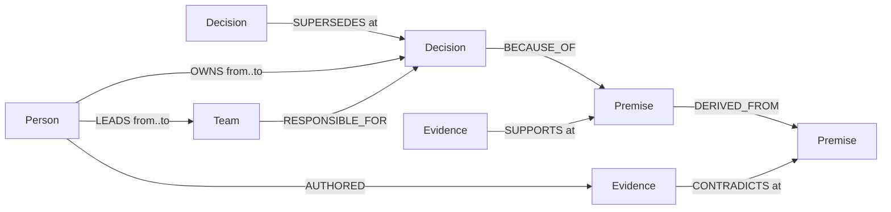

# Moot

**A company brain on FalkorDB. Ask a real organisation whether a decision still holds, who answers for it on any date, and why; get the answer with its graph path and the read-only Cypher behind it.**

[](https://github.com/danielAsaboro/moot/actions/workflows/ci.yml)
[](https://moot.bringaihome.xyz)
[](docs/falkordb.md)
[](LICENSE)

Moot reads an organisation's decisions, people, teams and documents into one FalkorDB graph where every edge carries its dates. Kubernetes is in it: 277 enhancement proposals (KEPs) of four SIGs, every SIG lead since 2018 dated to the commit, and the reasons each KEP states as exact quoted spans. Ask about a decision on any date and you get the answer that was true then, the path that proves it, and who to ask. An agent asks the same thing before it acts, and is stopped only when the graph shows the decision is gone.


**[Try it live](https://moot.bringaihome.xyz/app/?graph=gh_kubernetes_enhancements)** · **[Tour for judges](https://moot.bringaihome.xyz/#judges)** · **[Demo video](https://vimeo.com/1237038749)** · built for [Graph Hacks](https://www.wemakedevs.org/hackathons/falkordb), Company Brain track

## The result: K2, registered before it ran

57 held-out questions about Kubernetes as an organisation (which KEP replaced this one, who led its SIG on a date, was it in force then, did a person lead the owning SIG the day it was created), gold read from raw git history by a separate parser, same local model for every arm:

| | right (of 57) | tokens | $ | s per question |
|---|---|---|---|---|
| **the graph alone: one fixed graph query, no model** | **38** | **0** | **0** | **0.001** |
| **agent with Moot's graph tools** | **41** | 189k | 0.06 | 11 |
| agent with file and git tools | 22 | 724k | 0.23 | 40 |
| BM25 RAG | 26 | 131k | 0.04 | 26 |

- **The graph carries the answers.** With no model at all, one fixed query per question gets 38 right; a model with file and git tools over the same repositories gets 22.
- **The agent adds the long tail.** On top of the graph it gets 3 more, all "who led the SIG that owns this KEP on a date" asked for a date before the KEP itself existed (2019 and 2020), where the fixed query's team edge has not started yet and the agent reads the owning SIG and asks for its leaders that day. It loses none the fixed query gets.
- **Against the file agent:** 22 questions only the graph agent gets, 3 only the file agent gets, exact McNemar p < 0.001, at a quarter of the tokens and time. On K1, the smaller first study, the two were level (26 against 22 of 34). Every number, both studies, the fairness audit of the baselines and the parts of K2's prediction that failed: [docs/results.md](docs/results.md).

## Quickstart

```bash
docker compose up --build                 # FalkorDB + Moot, seeded: http://localhost:8000
pip install -e ".[dev]" && make demo      # or without Docker (embedded FalkorDB, Node 20+ for the UI)
moot ask "why do we cap uploads" --as-of 2025-06-01
moot ingest-keps --sig sig-auth           # Kubernetes KEPs, SIG teams and leads into their own graph
moot ingest-github thomvaill/log4brains   # any public repository's ADRs, history, PRs and CODEOWNERS
moot sentinel --since 2025-06-01          # what changed: broken reasons, retirements, changes without standing
moot verify                               # every number in this README re-derived from the committed eval output
```

MCP: `claude mcp add moot -- python3 -m moot.cli mcp`, or read-only over HTTP at [moot.bringaihome.xyz/mcp](https://moot.bringaihome.xyz/mcp). Commands, every tool and the full query catalogue: [docs/guide.md](docs/guide.md).

## How it works



A verdict is a path query. The audit walks a decision's reasons up to `depth` hops and collects every dated event known by `as_of`; pure rules then call a reason expired (latest event contradicts it), disputed (contradicted, then re-affirmed) or unchecked, and the decision RETIRED, MOOT, DISPUTED or HOLDS. The model never writes Cypher; every read goes through `GRAPH.RO_QUERY`, which FalkorDB refuses to run a write through.

```cypher
MATCH (d:Decision {id: $id})
MATCH p = (d)-[:BECAUSE_OF|DERIVED_FROM*1..4]->(pr:Premise)
OPTIONAL MATCH (e)-[r:SUPPORTS|CONTRADICTS]->(pr)
  WHERE r.at <= $as_of AND coalesce(r.stated, r.at) <= $as_of
OPTIONAL MATCH (a:Person)-[:AUTHORED]->(e)
RETURN pr, nodes(p) AS pn, length(p) AS hops,
       collect({id: e.id, rel: type(r), at: r.at, quote: r.quote, author: a.name})
ORDER BY hops
```

FalkorDB's algorithms answer the people questions: `algo.WCC` (knowledge that leaves with a person), `algo.betweenness` and `algo.pageRank` (who bridges whom), `algo.labelPropagation` (who really works together, against the official teams), `algo.SPpaths` (what a new document reaches, who connects two people). Labels, every query and why each is there: [docs/guide.md](docs/guide.md#the-graph-model-in-full).

## What's in it

- **A gate for agents:** `GET /api/gate`, MCP `check_action`, a Claude Code hook and a PR check; DENY only when the graph shows a decision is gone, otherwise proceed with any warning and who to ask ([docs/agents.md](docs/agents.md)).
- **Answers that cite:** every sentence of an agent answer quotes, word for word, a record a tool returned, checked in code; what fails is dropped, and nothing left is "not in Moot's graph".
- **Sentinel, what-if and re-open memos:** what changed between two dates with blast radius; a dated contradiction in your own sandbox; a drafted re-open that waits for a human to approve.
- **People:** who knows why, what leaves when someone does, hidden teams, who connects two people, viewer-scoped answers that say how much was withheld.
- **Connectors:** GitHub ADRs and CODEOWNERS, Kubernetes KEPs and `sigs.yaml`, Slack and issue-tracker exports, the HERB benchmark.
- **A demo company:** Larkspur, 8 people, built to show depth, dates and departures ([docs/larkspur.md](docs/larkspur.md)).

## Limits

- Moot holds what was written down and dates it; it is not a forecaster of which decisions will die ([docs/results.md](docs/results.md#forecasting-which-decisions-die)).
- Moot's Kubernetes graph and K2's gold come from the same repositories, so the fixed-query row measures how faithfully the graph holds that history; the contest is between agents with different tools on the same files.
- Every model arm used one local open-weights model (`qwen3.8:27b`); a stronger model may narrow the gap.
- The full list: [docs/results.md](docs/results.md#limits-in-full).

## Submission checklist

- [x] FalkorDB is the primary database and the product stops working without it: every verdict is a `ro_query` path query
- [x] Data: Kubernetes (277 KEPs, every SIG's leadership), 30 public repositories' ADRs (722 real decisions), any GitHub repository through a connector, and the synthetic 8-person Larkspur
- [x] Graph data model, key Cypher queries and graph algorithms ([above](#how-it-works), [full catalogue](docs/queries.md))
- [x] Setup in one command ([Quickstart](#quickstart)), MCP server ([setup](docs/mcp.md))
- [x] Demo video: https://vimeo.com/1237038749 · Live deployment: https://moot.bringaihome.xyz (FalkorDB Cloud)
- [x] AI use disclosed (below)

**AI disclosure.** Built with Claude (Claude Code) as a pair programmer under the author's direction: the author specified the graph model, verdict rules, query design and corpus; Claude wrote most of the code and docs, and the author reviewed and tested every piece. Inside the product a model narrates answers and proposes extractions (a local open-weights model, `qwen3.8:27b`); it never decides a verdict, never writes Cypher and never touches the database, and every quote it proposes is kept only if it is a literal span of the source.

MIT licence.
