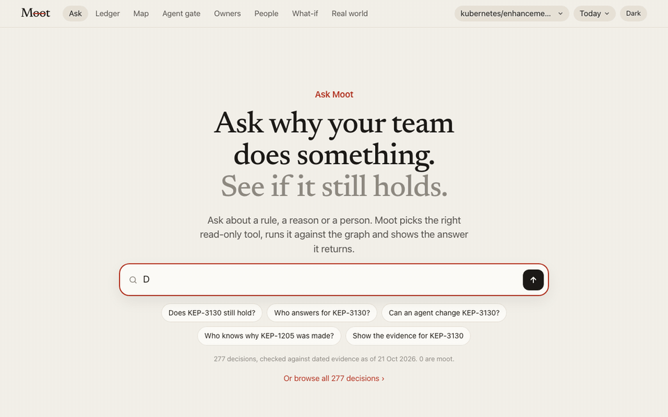
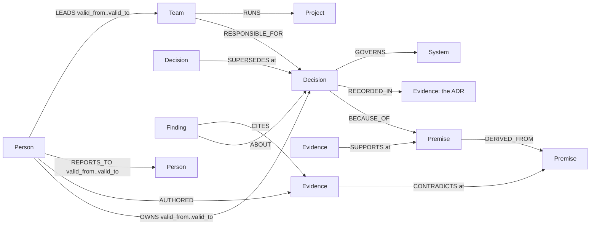

# Moot

**A company brain on FalkorDB: ask a real organisation whether a decision still holds, who answers for it on any date, and why. Every answer comes with its graph path and the Cypher behind it.**

[](https://github.com/danielAsaboro/moot/actions/workflows/ci.yml)
[](https://moot.bringaihome.xyz)
[](docs/falkordb.md)
[](LICENSE)



| 57 held-out questions about Kubernetes (K2, the registered confirmation), same model | right | tokens | $ | s per question |
|---|---|---|---|---|
| **agent with Moot's graph tools** | **41** | 189k | 0.06 | 11 |
| agent with file and git tools | 22 | 724k | 0.23 | 40 |
| BM25 RAG | 26 | 131k | 0.04 | 26 |
| **Moot alone: one fixed graph query, no model** | **38** | **0** | **0** | **0.001** |

**[Try it](https://moot.bringaihome.xyz/app/?graph=gh_kubernetes_enhancements)** · **[Tour for judges](https://moot.bringaihome.xyz/#judges)** · **[Demo video](https://vimeo.com/1237038749)** · built for [Graph Hacks](https://www.wemakedevs.org/hackathons/falkordb), Company Brain track

## Why the graph

"Who led the SIG that owns KEP-1884 on 27 June 2021?" takes two hops, the KEP's owning SIG and then that SIG's leaders on that day, and every edge in Moot's graph carries its dates; BM25 RAG got none of these questions right. On K2, the confirmation registered before it ran (four SIGs, six kinds of question), the same model answers 41 of 57 with Moot's graph tools against 22 with file and git tools over the same repositories (exact McNemar p < 0.001), with a quarter of the tokens in a quarter of the time; on K1 the two were level within the noise (26 against 22 of 34). Most of these questions need no model at all: one fixed graph query per question answers 38 of 57 at zero tokens in about a millisecond, so in Moot the model only routes the question and phrases the answer. And every answer carries the path it walked and the read-only Cypher that produced it, so a reader can check it.

## K1 and K2: the result in full

K1 asks what Kubernetes' own records say: which KEP replaced this one and when, who led its SIG on a date, whether it was in force on a date, and whether its authors still lead a SIG. The gold is read from raw git history by a separate parser (`moot/k1.py`); the questions were frozen and hashed before any arm ran ([register](docs/studies.md)). Same model, prompt and step budget for every model arm.

| arm (qwen3.8:27b, temperature 0) | test: exact match (95% CI) | dev | tokens (test) | $ at Groq's price (test) | median s per question (test) | tool calls (test) |
|---|---|---|---|---|---|---|
| **agent with Moot's graph tools** | **26/34** (0.60–0.88) | 11/12 | 131,474 | 0.042 | 11.0 | 74 |
| agent with file and git tools over the same checkouts | 22/34 (0.48–0.79) | 7/12 | 362,173 | 0.115 | 38.3 | 193 |
| BM25 RAG over the checkouts | 15/34 (0.29–0.61) | 7/12 | 84,837 | 0.026 | 28.4 | 0 |
| BM25 RAG over the checkouts and their history (post hoc) | 17/34 (0.34–0.66) | 7/12 | 67,031 | 0.020 | 22.8 | 0 |
| one fixed graph query per question, no model | 25/34 (0.57–0.85) | 10/12 | 0 | 0.000 | – | 0 |

- **Accuracy:** level with the file and git agent (only the graph agent right on 8 questions, only the file agent on 4, exact McNemar p = 0.39); ahead of BM25 RAG beyond chance (13 against 2, p = 0.007; against RAG over history 11 against 2, p = 0.022).
- **Fair baselines:** before any test answer was scored, three harness faults were fixed on dev and every affected arm re-run in full (the file agent could not reach `sigs.yaml` history or read past 6,000 characters; bare answers were dropped by the parser, which left RAG at 0); one name normaliser for every arm. Each is in the [register](docs/studies.md); earlier answers are kept, not scored.
- **Post hoc, a product fix:** SIG leadership is now dated to the `sigs.yaml` commit instead of the quarter (registered before K2); on the rebuilt graph the same fixed query answers 26 of 34, median under a millisecond. The frozen row above stays 25.
- **Shared source:** Moot's graph is built from the same repositories the gold is read from, so the fixed-query row measures how faithfully the graph holds that history. The contest is between agents with different tools. [Full tables](eval/results_k1.md).
### K2, the confirmation

K2 was registered before any of its questions existed and frozen before any arm ran: 78 questions over SIG Auth, Node, Network and Storage KEPs, K1's four kinds plus how many of a SIG's KEPs were in force on a date and whether a person led the owning SIG the day a KEP was created; the same model, harness and prompts as K1's final run, nothing tuned on its dev split.

| K2 arm (qwen3.8:27b, temperature 0) | test: exact match (95% CI) | dev | tokens (test) | $ at Groq's price (test) | median s per question (test) | tool calls (test) |
|---|---|---|---|---|---|---|
| **graph-tool agent** | **41/57** (0.59–0.82) | 13/21 | 189,181 | 0.060 | 10.9 | 117 |
| file and git agent over the same checkouts | 22/57 (0.27–0.52) | 12/21 | 723,781 | 0.229 | 40.5 | 271 |
| BM25 RAG at HEAD | 26/57 (0.33–0.58) | 10/21 | 131,478 | 0.040 | 25.8 | 0 |
| BM25 RAG over history (post hoc) | 27/57 (0.35–0.60) | 10/21 | 84,654 | 0.026 | 16.6 | 0 |
| fixed graph query, no model | 38/57 (0.54–0.78) | 14/21 | 0 | 0.000 | <0.001 | 0 |

- **Accuracy:** the graph agent is ahead of the file and git agent beyond chance (only the graph agent right on 22 questions, only the file agent on 3, exact McNemar p < 0.001) and of BM25 RAG (18 against 3, p = 0.001).
- **Against the registered prediction:** the margin over the file agent is at least K1's dev margin, as predicted, and largest where a date has to be joined to a person: whether someone led the owning SIG the day a KEP was created (11 of 11 against 1 of 11), and whether a KEP's authors lead a SIG today (11 against 6). Two parts did not hold: on how many of a SIG's KEPs were in force on a date every arm, the fixed query included, got 0 of 11 (the graph dates a KEP's force from its first implementable commit, the gold reads every status change), and RAG did not stay near zero (26 of 57). [Full tables](eval/results_k2.md).

- **Not a forecaster:** on 64 held-out real decisions Moot scored 52 against 59 for calling everything "still holds". Every forecasting study (H1, A1, H2, P1, the backtest) is in [docs/results.md](docs/results.md), every number kept.

## One decision, end to end

```
KEP-3130 KMS Observability                                   RETIRED
 ├─SUPERSEDES← KEP-3299 KMS v2 Improvements, 2022-05-09 (kep.yaml: replaces KEP-3130)
 ├─BECAUSE_OF→ "There is no guarantee that the timestamp of the operation is the same as the timestamp
 │              of the corresponding event in KMS"  (Motivation, exact span)
 └─RESPONSIBLE_FOR← SIG Auth: chairs Anish Ramasekar, Micah Hausler, Rita Zhang; tech leads David Eads,
                    Jordan Liggitt, Mo Khan (as of 2026-10-21; Mike Danese, Tim Allclair, Eric Chiang held seats before)
gate: DENY (retired) · ask: Anish Ramasekar, its author, still here
```

`moot ingest-keps` built this from 277 SIG Auth, Node, Network and Storage KEPs, every SIG's leadership since 2018 dated to the `sigs.yaml` commit, and the reasons each KEP states as exact quoted spans. Set the date and the answer is the one that was true then. An agent asks the same thing before it acts (`GET /api/gate`, MCP `check_action`, or `moot hook` in Claude Code) and gets DENY only when the graph shows the decision is gone; otherwise it proceeds, with any warning and who to ask.

## Checks and supporting numbers

| what | result | note |
|---|---|---|
| Router: ordinary questions the keyword rules misroute, routed right by a tool call (of 22) | **20** | keyword rules 0 (chosen because they fail) · [router eval](eval/results_router.md) |
| Oracle: the verdict FalkorDB's path query returns equals a plain-Python walk over the same edges | 2,000 of 2,000 random worlds | a check, not a win (`tests/test_oracle.py`) |
| NetworkX cross-check | WCC, betweenness ranking, PageRank's top premises and SPpaths lengths agree | betweenness scores differ, the order does not (`tests/test_algorithms.py`) |
| Unlearning (U1): remembered answers revoked when their evidence changes | over 12,792 monthly gate questions, so 0 stale answers are served, against 62 for a 90-day cache and 285 for a one-year cache | [U1](eval/results_unlearn.md) |
| Audit latency at 20,000 noise documents, p50 | **0.9 ms** | flat from 0 to 20,000 · [scale eval](eval/results_scale.md) |
| Larkspur: stale or retired decisions an agent was allowed to act on (of 20) | **0** | BM25 + change cues 4 · trust the ADR 20 · [gate eval](eval/results_gate.md); a consistency ceiling: synthetic, graded by its own spec |
| Larkspur, 90 questions (still holds? why? since when?): dead decisions called HOLDS (of 22) | **0** | RAG + same model 13 · RAG over stated reasons 7 · [head-to-head](eval/results_baseline.md); a consistency ceiling |

## What else is in the box

- **Any repository:** `moot ingest-github owner/repo` reads ADRs, history, pull requests and CODEOWNERS teams; quoted reasons are kept only as literal spans ([docs/reasons.md](docs/reasons.md)).
- **Agents:** a Claude Code hook, a pull-request check, `moot draft-pr`, MCP on stdio and read-only over HTTP at `/mcp` ([docs/agents.md](docs/agents.md), [docs/mcp.md](docs/mcp.md)).
- **What-if:** post a dated contradiction in your own sandbox copy and see which verdicts move.
- **Sentinel:** `moot sentinel --since 2025-06-01` lists what changed: reasons that broke (with blast radius and a draft re-open memo that waits for approval), retirements, reversals, and status changes by someone without standing on that date.
- **Answers that cite:** the agent loop (`moot/agentloop.py`) runs a fixed tool catalogue; every sentence must quote, word for word, a record a tool returned, checked in code (`moot/cite.py`), with one repair round; what fails is dropped, and nothing left is a plain "not in Moot's graph".
- **Who works with whom:** `moot teams` sets label-propagation communities of people who wrote records together beside the teams they officially answer for; `moot connect a b` is the shortest chain of shared records between two people.
- **Viewer-scoped answers:** `.moot/permissions.json` hides evidence by kind per viewer; a hidden record cannot move that viewer's verdict, and the answer says how many were withheld.
- **Exports in:** `moot ingest-slack` (a workspace export) and `moot ingest-issues` (GitHub or Jira) add dated chat and tickets that name a decision; `discussions` shows where it was talked about.
- **A demo company:** Larkspur, 8 people ([docs/larkspur.md](docs/larkspur.md)). [Architecture and screens](docs/architecture.md).

## Judging criteria: where to look

| criterion | the evidence |
|---|---|
| **Graph-native use of FalkorDB** | Verdicts *are* path queries over dated edges, all through `GRAPH.RO_QUERY` ([queries](docs/queries.md)); `algo.WCC`, `algo.betweenness`, `algo.pageRank`, `algo.SPpaths` answer who knows why, what leaves with a person, blast radius and what a PR broke; one named graph per organisation. Removing FalkorDB but keeping the rules drops Larkspur's head-to-head from 90/90 to 60/90 and H1 from 52/64 to 24/64. |
| **Agent effectiveness** | On K2, the registered confirmation, the same model with Moot's graph tools answers 41 of 57 Kubernetes questions against 22 with file and git tools (exact McNemar p < 0.001) and 26 for BM25 RAG, at a quarter of the file agent's tokens and time; on K1 it was level with the file agent (26 against 22 of 34). The gate answers before an agent acts, names who to ask, and blocks a coding agent's edit under a dead decision. On real decisions the old strict policy blocked everything it could not vouch for (59 of 59 that held); the product policy lets 4 of 5 later-dead decisions through but blocks only 8 of 59 that held. A tool-call router routes 20 of 22 questions the keyword rules misroute. |
| **Potential impact** | A real organisation end to end (Kubernetes), any public repository's ADRs and CODEOWNERS, and an agent gate that works over HTTP, MCP and in the editor. |
| **Technical excellence** | One-command setup (`docker compose up --build`, or `make demo`), 186 tests, CI on FalkorDB v4.22.1 and v4.18.3 plus the UI build, `moot verify --rerun` re-derives every number above from committed inputs, `make judge-check` runs it all. |
| **Explainability and provenance** | Every answer carries its path, evidence ids and dates, the Cypher it ran and a digest of the rows; every model-proposed quote is a checked literal span with its source and model. "No evidence" is never "holds". |
| **Creativity and presentation** | A brain that refuses: MOOT, DENY or "not in the graph" instead of an answer; isometric drawings of the real rows, the ruled ledger, the [video](https://vimeo.com/1237038749) and the [blog](https://moot.bringaihome.xyz/i-built-a-company-brain-that-refuses-to-answer-questions/). |

## Submission checklist

- [x] FalkorDB is the primary database and the product stops working without it: every verdict is a `ro_query` path query
- [x] Data: a synthetic 8-person company (Larkspur: 30 decisions, 238 documents: 30 ADRs and 208 PRs, tickets, chat and docs), 25 real public ADRs checked against GitHub and OSV, a backtest on 722 real decisions from 30 public repositories, and a connector for any public GitHub repository (four ingested: 75 decisions, 59 pull requests, 157 stated reasons)
- [x] Graph data model, key Cypher queries and graph algorithms ([below](#graph-model), [full catalogue](docs/queries.md))
- [x] Setup in one command ([Run it](#run-it)), MCP server ([setup](docs/mcp.md))
- [x] Demo video: https://vimeo.com/1237038749
- [x] Live deployment: https://moot.bringaihome.xyz (FalkorDB Cloud)
- [x] AI use disclosed ([below](#ai-disclosure))

## Graph model

One named graph per company (`select_graph(tenant)`): `gh_kubernetes_enhancements` (Kubernetes, the hosted app's default), `larkspur` (the demo company), `public_adrs` (real ADRs), `backtest` (30 real repositories), and one `gh_<owner>_<repo>` graph per repository brought in with `moot ingest-github`. All of them are selectable in the UI (the Graph menu), the API (`?graph=`) and the MCP audit, gate, ledger and people tools (`graph=`).



| Label | Key properties | Meaning |
|---|---|---|
| `Decision` | id, title, summary, decided_on, source | a standing decision (one per ADR) |
| `Premise` | id, text, kind (stated / unwritten), unchecked; for a stated reason: quote, span, section, source, extracted_by | a reason behind one or more decisions |
| `Evidence` | id, kind (adr / pr / ticket / chat / doc / check), title, date, excerpt | a dated document |
| `Person` | id, name, role, joined, left | people, with tenure |
| `System` | id, name | what a decision governs |
| `Finding` | id, verdict, kind (verdict / reopen / ruling), as_of, digest | Moot's own memory, written only after a human approves |
| `Team` | id, name, source | a team that answers for decisions (a Kubernetes SIG, a CODEOWNERS team); its leads carry dated windows |
| `Project` | id, name, description | what a team runs (a SIG subproject, a CODEOWNERS path) |

Every event edge (`SUPPORTS`, `CONTRADICTS`, `SUPERSEDES`, `RETIRES`) carries `at`, the date it took effect, and optionally `stated`, the date it became known; an edge a model proposed also carries the exact `quote` and `extracted_by`. Ownership and reporting lines carry validity windows. Indexes: a range index on `id` for every label, full-text on `Decision(title, summary)`, `Premise(text)` and `Evidence(title, excerpt)`. The full edge list is in [docs/queries.md](docs/queries.md).

## The queries and algorithms Moot depends on

The model never writes Cypher. These are the core of the fixed catalogue in `moot/tools.py`; the [full catalogue](docs/queries.md) has all of them.

**The audit**: premises up to `depth` hops, with every dated event known by `as_of`. This query is the verdict.

```cypher
MATCH (d:Decision {id: $id})
MATCH p = (d)-[:BECAUSE_OF|DERIVED_FROM*1..4]->(pr:Premise)
OPTIONAL MATCH (e)-[r:SUPPORTS|CONTRADICTS]->(pr)
  WHERE r.at <= $as_of AND coalesce(r.stated, r.at) <= $as_of
OPTIONAL MATCH (a:Person)-[:AUTHORED]->(e)
RETURN pr, nodes(p) AS pn, length(p) AS hops,
       collect({id: e.id, rel: type(r), at: r.at, quote: r.quote, author: a.name})
ORDER BY hops
```

Pure rules in `moot/verdict.py` then decide: a premise is **expired** when its latest event is a contradiction, **disputed** when contradicted then re-affirmed, **unevidenced** when nothing ever checked it. A decision is **RETIRED** if a dated `SUPERSEDES`/`RETIRES` points at it, **UNDOCUMENTED** with no premise, **MOOT** if any premise within `depth` hops is expired. The **agent gate** audits at depth 6 and answers **ALLOW**, **DENY** or **REVALIDATE** (no evidence is not "holds").

**Who knows why** a decision was made: everyone who owns it, wrote its ADR, or wrote evidence on any reason below it.

```cypher
MATCH (d:Decision {id: $id})
OPTIONAL MATCH (d)-[:BECAUSE_OF|DERIVED_FROM*1..6]->(pr:Premise)<-[:SUPPORTS|CONTRADICTS]-(e:Evidence)<-[:AUTHORED]-(p1:Person)
OPTIONAL MATCH (d)-[:RECORDED_IN]->(:Evidence)<-[:AUTHORED]-(p2:Person)
OPTIONAL MATCH (p3:Person)-[o:OWNS]->(d) WHERE o.valid_from <= $as_of
RETURN collect(DISTINCT p1.id) + collect(DISTINCT p2.id) + collect(DISTINCT p3.id)
```

**What leaves with them**: the who-knows-why rows are written into a scratch graph as `KNOWS` edges between each person still here and each decision they know; the person leaving is removed and `algo.WCC` finds the knowledge islands. An island with decisions and no person left in it is knowledge that walks out of the door. The company graph is never written, and the scratch graph is deleted before the answer returns. (We started with `GRAPH.COPY`; on macOS the embedded server's copy fork can deadlock, so the projection is built from rows.)

```cypher
CALL algo.WCC({nodeLabels: ['Person','Decision'], relationshipTypes: ['KNOWS','KNOWN_BY']}) YIELD node, componentId
RETURN componentId, collect(CASE WHEN node:Decision THEN node.id END), collect(CASE WHEN node:Person THEN node.id END)
```

**Bridges between people**: `algo.betweenness` on the same projection ranks the people through whom most knowledge runs. Its scores are not NetworkX's exact Brandes values on this projection, but the people come out in the same order, which is what Moot reports (`tests/test_algorithms.py` cross-checks WCC, betweenness ranks, PageRank's top premises and SPpaths lengths against NetworkX). **Single points of failure**: reasons that two or more live decisions rest on, vouched for by one document or one person still here.

**Blast radius of a reason**: every decision that rests on it, directly or through derived reasons, plus `algo.pageRank` over the dependency graph for comparison.

```cypher
MATCH (pr:Premise {id: $id})
MATCH p = (d:Decision)-[:BECAUSE_OF|DERIVED_FROM*1..6]->(pr)
RETURN DISTINCT d.id, d.title, length(p)
```

**What did this PR break?** `algo.SPpaths` from a new document to every decision it can reach.

```cypher
MATCH (e:Evidence {id: $id}), (d:Decision)
CALL algo.SPpaths({sourceNode: e, targetNode: d,
     relTypes: ['CONTRADICTS','SUPPORTS','BECAUSE_OF','DERIVED_FROM'], relDirection: 'both', maxLen: 6, pathCount: 1})
YIELD path RETURN d.id, length(path), nodes(path)
```

**Orphaned decisions**: walk `REPORTS_TO` as it stood the day the owner left, skipping managers who also left.

```cypher
MATCH path = (o:Person {id: $pid})-[:REPORTS_TO*1..5]->(m:Person)
WHERE all(r IN relationships(path) WHERE r.valid_from <= $left_on AND (r.valid_to = '' OR r.valid_to > $left_on))
  AND (m.left = '' OR m.left > $as_of)
RETURN m.id, m.name, length(path) ORDER BY length(path) LIMIT 1
```

Read-only is enforced by the engine: every read is `GRAPH.RO_QUERY`, which FalkorDB refuses to run a write through. The UI's **Cypher** tab shows the exact queries each answer ran, with row counts and milliseconds.

## Run it

One command, with Docker (FalkorDB + Moot, seeded on start):

```bash
docker compose up --build     # http://localhost:8000
```

Or locally without Docker (FalkorDB embedded through `falkordblite`, Node 20+ for the UI):

```bash
pip install -e ".[dev]" && make demo     # db + seed + ui + serve on http://localhost:8000
```

Then:

```bash
moot ask "why do we cap uploads" --depth 1 --as-of 2025-06-01
moot ledger                              # every decision with its verdict, MOOT first
moot departure marcus                    # what leaves with a person
moot people                              # who only knows what: bus factor and betweenness per person
moot ingest-github thomvaill/log4brains  # any public repo's ADRs, history and PRs into graph gh_thomvaill_log4brains, audited
moot ingest-keps --sig sig-auth          # Kubernetes KEPs, SIG teams and leads into graph gh_kubernetes_enhancements
moot gate-paths services/uploads/a.py    # gate every decision governing these files (.moot/paths.json); exit 1 on DENY
moot hook                                # Claude Code PreToolUse hook (docs/agents.md)
moot draft-pr thomvaill/log4brains <id>  # the patch + PR body that re-opens a MOOT decision; nothing is pushed
make judge-check                         # tests, every README number re-derived, the held-out gold hash
moot packet D01                          # the evidence packet behind one verdict, as Markdown
moot verify                              # every number in this README checked against the eval JSON, charts included
moot mcp                                 # MCP server on stdio (Claude Desktop, Claude Code, Cursor)
make test                                # pytest; CI runs it and moot verify --rerun against FalkorDB v4.22 and v4.18
```

`ingest-github` reads stated reasons with a local model through [Ollama](https://ollama.com) (`qwen3.8:27b` by default; `MOOT_REASONS_BACKEND=groq` with a `GROQ_API_KEY` instead) and caches every reply; without a model it reads the cache and leaves unread ADRs UNDOCUMENTED. `python3 eval/eval_reasons.py --cached` rebuilds the before/after table, `python3 eval/charts.py` the charts, `node eval/screens.mjs` the screenshots.

**MCP**: `claude mcp add moot -- python3 -m moot.cli mcp`, or `{"mcpServers": {"moot": {"command": "python3", "args": ["-m", "moot.cli", "mcp"], "cwd": "/path/to/moot"}}}` for Claude Desktop and Cursor. The agent's first call is `check_action`; [docs/mcp.md](docs/mcp.md) lists every tool. `GROQ_API_KEY` in `.env` turns on the live model (`moot/llm.py`, `openai/gpt-oss-120b` by default, `ANTHROPIC_API_KEY` as the alternative): it picks the answer tool by tool call and narrates, under a daily spend cap (`MOOT_LLM_DAILY_USD`, default $1), and falls back to the keyword rules and templates when it is off, over the cap or wrong. On 22 ordinary questions the keyword rules misroute it routes 20 correctly ([router eval](eval/results_router.md)). Verdicts never need it.

## Honest limits

- **Not a forecaster.** On held-out real decisions Moot does worse than calling everything HOLDS (52 against 59 of 64), and its flags on real history are confirmed at chance (1 of 12). It gives the reason, the path, the date and who to ask, not a prediction.
- **The gate trades one error for another.** The strict policy blocked all 59 held-out decisions that held; the product policy ("warn") lets them through with a warning and who to ask, and so also lets through 4 of the 5 that later died.
- **Larkspur is synthetic**, graded by its own spec: its zeros are a consistency ceiling. The backtest (722 real decisions, labelled by their maintainers) is graded by strangers; its six tool deaths are too few to rank recall.
- **Only what was written down.** Three in four abandoned real decisions picked no outside tool, so no outside check could see them die.
- **The gate follows the edges it is given**, junk included, which is why every DENY names the evidence id.
- **No evidence is not "holds"**: an unchecked reason is shown as unverified.
- **A stated reason is what the ADR says, not what is true.** The span check stops invented quotes, not a wrong reading of a real one; one local model, one run, no labelled set to score extraction.
- **Knowing is read from authorship**: KEP authors and approvers, git authors elsewhere. SIG leadership is dated to the `sigs.yaml` commit (K1 was frozen against quarter dating; its deterministic row is scored on that graph).
- **The Kubernetes graph covers four SIGs' KEPs** (every SIG's leadership), not the whole project; later KEPs rarely speak to earlier reasons, so most KEPs hold for want of contradiction, and the pass that reads them for SUPPORTS/CONTRADICTS edges is still running.
- The full-text resolver is keyword-based: a question with no word in common with a decision returns "unknown entity".

## AI disclosure

Built with Claude (Claude Code) as a pair programmer under the author's direction: the graph model, verdict rules, query design and corpus spec were specified by the author; Claude wrote most of the code, the synthetic documents and this README from those specifications, and the author reviewed and tested every piece. Inside the product, a model narrates answers and proposes extractions: stated reasons in real ADRs are read by a local open-weights model (`qwen3.8:27b` through Ollama), and the S3 retrieval arms use the same model. It never decides a verdict, never writes Cypher and never touches the database; every quote it proposes is kept only if it is a literal span of the source. Rulings, findings and handovers are written by fixed queries after a human approves, never by the model.

## License

MIT.
