# Moot

**A company brain on FalkorDB: an organisation's decisions, people, teams and documents in one graph, and for any standing decision the answer to "does this still hold, who answers for it today, and why?", with the evidence path.**

[](https://github.com/danielAsaboro/moot/actions/workflows/ci.yml)
[](https://moot.bringaihome.xyz)
[](docs/falkordb.md)
[](LICENSE)

| | |
|---|---|
| **Try it** | [Live app](https://moot.bringaihome.xyz) · [Kubernetes as a company](https://moot.bringaihome.xyz/app/ledger/?graph=gh_kubernetes_enhancements) · [does KEP-3130 still hold?](https://moot.bringaihome.xyz/app/ledger/?graph=gh_kubernetes_enhancements&d=KEP-3130) · [the Cypher it ran](https://moot.bringaihome.xyz/app/?graph=larkspur&d=D01&tab=cypher) · [post a change](https://moot.bringaihome.xyz/app/whatif/?graph=larkspur&premise=p_soc2_cert) · [tour for judges](https://moot.bringaihome.xyz/#judges) |
| **Watch / read** | [Demo video](https://vimeo.com/1237038749) · [Blog: I built a company brain that refuses to answer questions](https://moot.bringaihome.xyz/i-built-a-company-brain-that-refuses-to-answer-questions/) |
| **Check it** | `make judge-check` · [Results, losses included](#results-losses-included) · [Studies register](docs/studies.md) · [Evaluation](docs/evaluation.md) |
| **Build on it** | [Query catalogue](docs/queries.md) · [How FalkorDB is used](docs/falkordb.md) · [MCP setup, local and over HTTP](docs/mcp.md) · [Coding-agent hook](docs/agents.md) · [Run it](#run-it) |

Built for [Graph Hacks](https://www.wemakedevs.org/hackathons/falkordb) (WeMakeDevs x FalkorDB), track **Company Brain**. [How it maps to the six judging criteria](#judging-criteria-where-to-look).


## What you can check in five minutes

**1. A whole organisation in one graph.** `moot ingest-keps` reads Kubernetes as a company: each Kubernetes Enhancement Proposal in force is a decision, dated by the commit that made it implementable; withdrawn, replaced and deferred KEPs are retired by the commit that said so, and `replaces` becomes a dated `SUPERSEDES`. The SIGs are teams, read from `sigs.yaml`'s history with every chair and tech lead's window since 2018 (emeritus leads are people who left the seat), their subprojects are projects, the KEP authors and approvers are people who know why, and the reasons each KEP states in its Summary and Motivation are kept as exact quoted spans. Ask about one:

```
KEP-3130 KMS Observability                                   RETIRED
 ├─SUPERSEDES← KEP-3299 KMS v2 Improvements, 2022-05-09 (kep.yaml: replaces KEP-3130)
 ├─BECAUSE_OF→ "There is no guarantee that the timestamp of the operation is the same as the timestamp
 │              of the corresponding event in KMS"  (Motivation, exact span)
 └─RESPONSIBLE_FOR← SIG Auth: chairs Anish Ramasekar, Micah Hausler, Rita Zhang; tech leads David Eads,
                    Jordan Liggitt, Mo Khan (as of 2026-10-21; Mike Danese, Tim Allclair, Eric Chiang held seats before)
gate: DENY (retired) · ask: Anish Ramasekar, its author, still here
```

The same queries answer it for the demo company (Larkspur, 8 people, below), for four real repositories' ADR folders (`moot ingest-github`), and for any repository's CODEOWNERS teams.

**2. Provenance you can click.** Every answer carries the traversal path, the evidence ids and dates, and the exact read-only Cypher it ran with rows and milliseconds; every stated reason carries its quote, character span, section, source link and the model that proposed it, and a validator drops any quote that is not a literal span.

**3. The graph changes as the agent works.** *Post a change* applies a dated contradiction to a reason in your own sandbox copy of the graph and shows which verdicts and gates move; Reset deletes it (`moot/sandbox.py`; the company graph is only read, and a test checks its digest). A human's approval writes a Finding back, and remembered answers are revoked the moment the rows under them change. In front of coding agents, `moot hook` (a Claude Code `PreToolUse` hook) blocks an edit to a file governed by a decision whose reason is dead, with the evidence path and who to ask: the owner, else whoever was next up their reporting line, else the team's current leads ([docs/agents.md](docs/agents.md)). The read-only tools are also a public MCP server over HTTP at `/mcp`.

**4. Correct by construction, and labelled so.** These hold because of how Moot is built, so they are checks, not measured wins: the verdict FalkorDB's path query returns equals a plain-Python walk over the same edges in 2,000 random worlds (`tests/test_oracle.py`); WCC, betweenness ranking, PageRank and SPpaths agree with NetworkX (`tests/test_algorithms.py`); over 12,792 monthly gate questions on real and demo graphs, remembered answers are revoked whenever their evidence changes, so 0 stale answers are served, against 62 for a 90-day cache and 285 for a one-year cache ([U1](eval/results_unlearn.md)); and every number in this README is re-derived by `moot verify --rerun`.

## Results, losses included

Every study was registered in [docs/studies.md](docs/studies.md) before it ran, and the results ship whatever they are. The short version: **on independent real data, Moot does not predict which decisions die better than the baselines.** Its value is the graph, the provenance and the gate in front of agents, not a forecast.

| question | Moot | baselines | source |
|---|---|---|---|
| **Held-out (H1):** 64 real decisions in force on 2023-10-17, graded by what their repositories did by 2026-10-17 (5 died): right | 52/64 (0.81) | everything HOLDS 59/64 · BM25 RAG 57/64 · LLM agent with GitHub/OSV tools 55/64 (64 of 64 answered) · age rule 28/64 · Moot rules without FalkorDB 24/64 | [results_heldout.md](eval/results_heldout.md) |
| H1: deaths caught, false alarms | 1 of 5, 8 of 59 | BM25 RAG 2 and 4 · age rule 3 and 34 · LLM agent 1 and 5 | [results_heldout.md](eval/results_heldout.md) |
| **Agents on real decisions (A1):** later-dead decisions an agent was allowed to act on / decisions that held but were blocked | 0 of 5 / 59 of 59 | trust the ADR 5 / 0 · BM25 RAG 3 / 4 · LLM agent 4 / 5 · age rule 2 / 34 | [results_heldout.md](eval/results_heldout.md#what-an-agent-would-have-been-allowed-to-do-study-a1-test-split) |
| **Precision on real history (P1):** flags later confirmed by the repository within three years | 1 of 12 (0.08) | age rule 3 of 45 (0.07) · random flagger 0.13 | [results_precision.md](eval/results_precision.md) |
| Real repositories: decisions caught dead before their own maintainers (of 6 tool deaths) | **2** | age ≥ 3 years 3 · random 1.4 · trust the ADR 0 | [backtest, 30 public repos](eval/results_backtest.md) |
| Real repositories: flags on decisions still listed in force, each with a dated reason | **22** (15 real, 2 false alarms) | age ≥ 3 years 73, none with a reason | [backtest](eval/results_backtest.md#every-flag-on-a-decision-its-repository-still-lists-as-in-force) |
| EnterpriseRAG-Bench conflicts: superseded document still in the model's context (of 20, lower is better) | **13** | BM25 14: a tie | [blind supersession cut](eval/results_erag.md) |
| Real public ADRs denied with a dated reason (of 25) | **7** | 23 of the 25 still say *accepted* | [real-world audit](docs/evaluation.md#real-world-proof-public-adrs) |
| Router: ordinary questions the keyword rules misroute, routed right by a tool call (of 22) | **20** | keyword rules 0 (chosen because they fail) | [router eval](eval/results_router.md) |
| Audit latency at 20,000 noise documents, p50 | **0.9 ms** | flat from 0 to 20,000 | [scale eval](eval/results_scale.md) |

**Read it plainly.** On H1 calling everything HOLDS beats Moot's gate (59 against 52, exact McNemar p = 0.04), as the registration predicted: most of Moot's 8 false alarms are licence changes (Terraform, Nomad, Elasticsearch) that teams lived with. Applying the rule Moot already uses for ingested repositories, licence hits are DISPUTED unless a stated reason depends on them, gives 56/64 as a post-hoc row and catches none of the 5 deaths. In A1 the gate lets no later-dead decision through, but only because it blocks everything: with no dated evidence either way it says REVALIDATE, and that costs 59 of 59 decisions that held. What it adds is who to ask. On precision Moot is at chance. The backtest is where its flags read best: each names a dated reason a reviewer can check in a minute.

**On real history.** Rewound month by month with only the evidence of the day, Moot said DENY 350 days before GOV.UK replaced MongoDB (the SSPL licence change, October 2018), and 1,435 days before GOV.UK deprecated its Elasticsearch logging ADR; median lead 892 days. It found 15 ADRs still marked accepted whose reasons died upstream (the Terraform and Consul licence change, Lunr.js and sqlx gone quiet) and that nobody has revisited. ([backtest](eval/results_backtest.md))

On recall the backtest cannot rank anything: the age rule catches 3 of the 6 deaths to Moot's 2, and six is too few to separate them. The difference is precision. To catch its 3, the age rule raises 73 flags on decisions still in force and says nothing about why; Moot raises 22, each naming a dated fact (a licence change, a repository gone quiet) that a reviewer can check in a minute, and reading all 22 found 15 whose reason really died upstream and 2 false alarms. On EnterpriseRAG-Bench, built blind, Moot's supersession cut ties BM25.

### The consistency ceiling: Larkspur, a synthetic company graded by its own spec

Larkspur's answer key comes from the same spec as its graph, so these rows show the rules and the queries agree with the spec, not that Moot predicts anything.

| question | Moot | baseline | source |
|---|---|---|---|
| Larkspur: stale or retired decisions an agent was allowed to act on (of 20) | **0** | BM25 + change cues 4 · trust the ADR 20 | [gate eval](eval/results_gate.md) |
| Larkspur, 90 questions (still holds? why? since when?): dead decisions called HOLDS (of 22) | **0** | RAG + same model 13 · RAG over stated reasons 7 | [head-to-head](eval/results_baseline.md) |

<p align="center">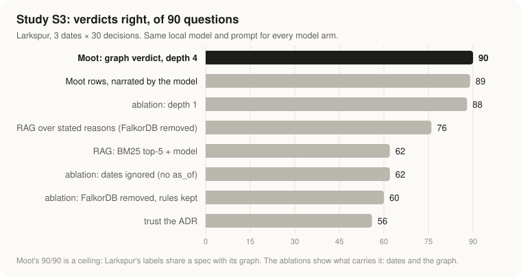</p>

On the same 90 questions Moot gets 90/90 verdicts and 24/24 "since when" dates exactly; plain RAG with the same local model gets 62/90 and 8/24. The ablations say what carries it: ignoring dates drops Moot to 62/90, removing FalkorDB (same rules over retrieved documents) to 60/90, depth 1 to 88/90. Larkspur's labels share a spec with its graph, so Moot's row is a ceiling, not extraction quality ([threats](eval/results_baseline.md#threats-to-validity-worst-first)).

<p align="center">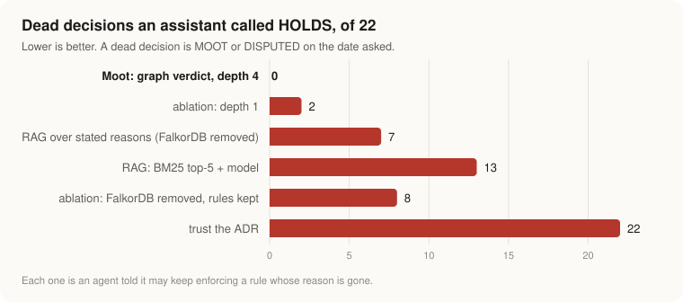</p>

Every number above is checked by `moot verify` against the JSON the evals wrote (`moot verify --rerun` re-derives it from committed inputs), and the charts are drawn from the same files by `eval/charts.py` (verify fails if a committed chart drifts). Studies are registered before they run, withdrawn results stay listed with the reason ([docs/studies.md](docs/studies.md)), and every table is in [docs/evaluation.md](docs/evaluation.md).

## The demo company in 40 seconds

Ask **"Why do we cap uploads at 10 MB?"** A doc-chat brain finds the ADR and says: because the gateway rejects bodies over 10 MB. Moot answers **MOOT**:

```
D01 Cap file uploads at 10 MB
 └─BECAUSE_OF→ "All file uploads pass through the API gateway"
                └─DERIVED_FROM→ "The API gateway enforces a 10 MB request body limit"
                                 ←CONTRADICTS─ PR-412, 2026-03-02 "Raise the API gateway body limit to 100 MB"
owner: Ada Okafor, left 2026-05-15 · D02 and D03 rest on the same dead reason
```

- Flip **depth 1 → 4**: at depth 1 the verdict is HOLDS, because the stated reason is intact. The dead reason is two hops down. That hop is what a graph buys you.
- Set **as of 2025-06-01**: HOLDS again, because PR-412 did not exist yet. Every edge is dated.
- Ask an agent's question, **"may I enforce D01?"** (`GET /api/gate/D01`, or the MCP tool `check_action`): **DENY**, with the path to PR-412.
- Ask **since when**: MOOT since 2026-03-02, after HOLDS from 2025-02-10. Moot re-audits on every date something in the decision's graph happened.
- Ask **who knows why**: Marcus Chen, who wrote PR-412, and Ada Okafor, the owner, who left. Bus factor 1. **What leaves with Marcus?** Five live decisions nobody else here can explain, five reasons only he wrote evidence on, and the Uploads API.
- Point it at a real repository: `moot ingest-github thomvaill/log4brains` reads its ADR folder, git history and pull requests into a new graph, reads the reasons each ADR states in its own words (kept only as exact quoted spans), and audits every decision against GitHub, OSV and the repository's later ADRs.

Verdicts are FalkorDB path queries. The model only narrates and proposes quotes; every id it cites is checked against the rows, every quote against the document, and it never writes Cypher.

## Real repositories: reading the reasons an ADR states

Real ADRs rarely name a tool in their title, so the first version of the GitHub connector left most of them UNDOCUMENTED: it had nothing it could check. Now a model reads each ADR's Context, Decision and Consequences and proposes the reasons it states; a validator keeps a reason only if its quote is a literal span of the ADR (outside the title and Status line), and stores the span, section, document and model on the `Premise`. A reason that depends on a catalogued tool is linked (`DERIVED_FROM`) to that tool's GitHub and OSV checks, and each later ADR is judged against earlier reasons, with exact quotes, as dated `SUPPORTS` / `CONTRADICTS` evidence. Replies are cached in `data/github/<repo>/reasons.json`, so CI and the live site never call a model.

<p align="center">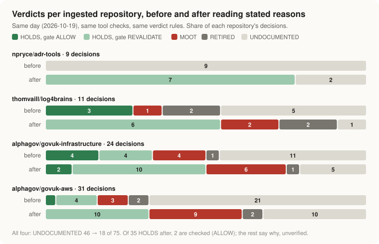</p>

On the four ingested repositories, UNDOCUMENTED fell from 46 to 18 of 75 decisions. Of the 35 HOLDS after, 2 pass the gate; the rest say why but nobody has evidence either way, so the gate answers REVALIDATE, not ALLOW. The reading also found 5 new MOOT decisions, each through a dated contradiction a human can check: 4 from the maintenance check on a tool a stated reason depends on (Puppet, last commit to main 2024-12-11) and 1 from a later ADR's own words (log4brains: Lerna "does not integrate well with Git Flow processes"). Licence and vulnerability hits are advisory here: Terraform's move to BUSL-1.1 or an OSV advisory on Kubernetes makes a decision DISPUTED, so its owner rules, and it can make one MOOT only through a reason the ADR states that depends on it. None of the 31 tool-linked reasons does, so 8 decisions that an earlier version called MOOT on those checks alone (GOV.UK's EKS choices among them) are DISPUTED now. And the gate got stricter, not looser: ALLOW went from 8 to 2, because five decisions that passed on their title's tool checks now also rest on a reason their ADR states and nobody has checked. 157 reasons kept from 75 ADRs, 6 dropped by the validator; 18 decisions are still UNDOCUMENTED. Full table, what the validator dropped, and every verdict that changed: [eval/results_reasons.md](eval/results_reasons.md).

## Screens

| | |
|---|---|
| 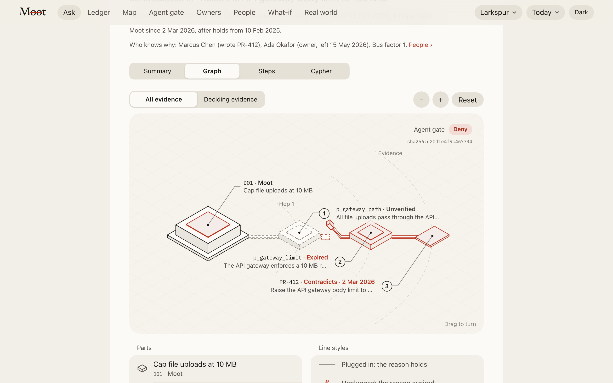 **Evidence path.** Every verdict is drawn from the rows FalkorDB returned: D01, the reason, the expired reason behind it, PR-412. | 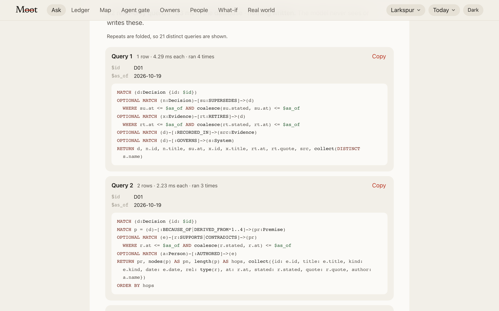 **Cypher.** The exact read-only queries each answer ran, with parameters, row counts and milliseconds. |
| 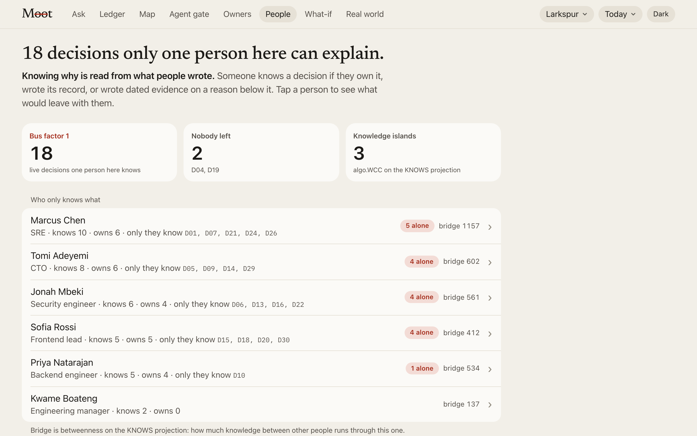 **People.** Who only knows what: bus factor, `algo.WCC` knowledge islands and betweenness on a KNOWS projection. | 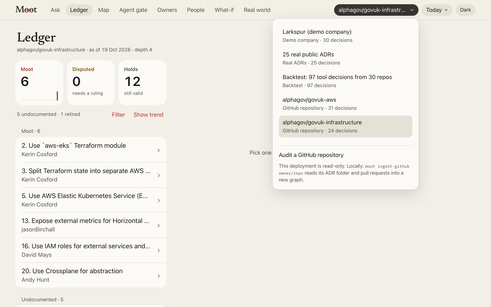 **Graph picker.** One named graph per company: Larkspur, real ADRs, the backtest, every ingested repository. |
| 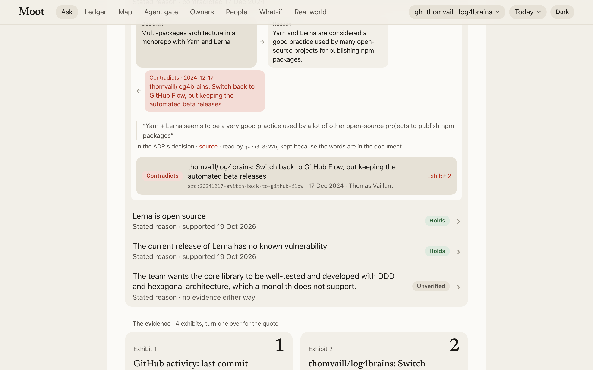 **Stated reasons.** log4brains chose Lerna because "Yarn + Lerna seems to be a very good practice"; its own later ADR says Lerna "does not integrate well". The exact words, the source and the model that read them. | 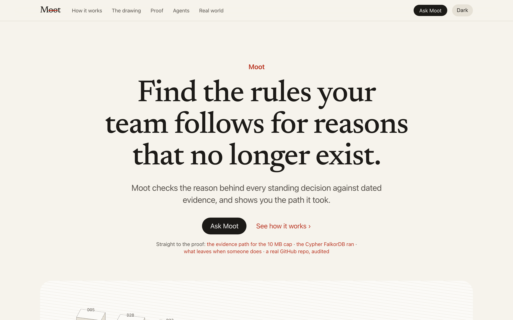 **Landing.** Straight links to the evidence path, the Cypher, People and an audited repository. |

## Judging criteria: where to look

| criterion | the evidence |
|---|---|
| **Graph-native use of FalkorDB** | Verdicts *are* path queries: `(Decision)-[:BECAUSE_OF\|DERIVED_FROM*1..depth]->(Premise)<-[:SUPPORTS\|CONTRADICTS]-(Evidence)` with dated edges, all through `GRAPH.RO_QUERY` ([queries](docs/queries.md)). `algo.WCC`, `algo.betweenness`, `algo.pageRank` and `algo.SPpaths` answer who knows why, what leaves with a person, blast radius and what a PR broke. One named graph per company; Findings, rulings and handovers are written back only after approval ([docs/falkordb.md](docs/falkordb.md)). Removing FalkorDB but keeping the rules drops S3 from 90/90 to 60/90. |
| **Agent effectiveness** | The gate (`check_action`, `GET /api/gate`, MCP, `moot hook`) is what agents call before acting. On held-out real decisions it let 0 of 5 later-dead decisions through, at the cost of blocking 59 of 59 that held (REVALIDATE: no dated evidence either way), and every block names who to ask ([A1](eval/results_heldout.md#what-an-agent-would-have-been-allowed-to-do-study-a1-test-split)). A coding agent editing a file governed by a dead decision is stopped with the evidence path ([docs/agents.md](docs/agents.md)). A tool-call router sends 20 of 22 questions the keyword rules misroute to the right tool ([router](eval/results_router.md)). On Larkspur the gate let 0 of 20 stale or retired decisions through, against 4 for BM25 with change cues and 20 for trusting the ADR ([gate eval](eval/results_gate.md)), a consistency ceiling. |
| **Potential impact** | Every organisation inherits rules whose reasons died quietly and whose owners moved on. Moot reads a real one end to end (Kubernetes: KEPs, SIG teams and their leads since 2018, authors and approvers), any public repository's ADR folder and CODEOWNERS (`moot ingest-github`: four in the live app, with stated reasons read from their ADR text, [before/after](eval/results_reasons.md)), and 25 real public ADRs checked against GitHub and OSV. |
| **Technical excellence** | One-command setup (`docker compose up --build`, or `make demo`), 155 tests, CI on FalkorDB v4.22.1 and v4.18.3 plus the UI build, `moot verify --rerun` re-derives every README number from committed inputs. Deployed at [moot.bringaihome.xyz](https://moot.bringaihome.xyz) on FalkorDB Cloud. |
| **Explainability and provenance** | Every answer carries its traversal path, the evidence ids and dates, the Cypher it ran, and a digest of the rows it read. A model's citation is checked against the rows; a stated reason's quote against the document, with its character span, section, source link and model on the node. "No evidence" is never "holds". |
| **Creativity and presentation** | A brain that refuses: it says MOOT, REVALIDATE or "not in the graph" instead of an answer. Isometric drawings of the real rows, an unplugged cable for an expired reason, the ruled ledger, the [video](https://vimeo.com/1237038749) and the [blog](https://moot.bringaihome.xyz/i-built-a-company-brain-that-refuses-to-answer-questions/). |

## Submission checklist

- [x] FalkorDB is the primary database and the product stops working without it: every verdict is a `ro_query` path query
- [x] Data: a synthetic 8-person company (Larkspur: 30 decisions, 238 documents: 30 ADRs and 208 PRs, tickets, chat and docs), 25 real public ADRs checked against GitHub and OSV, a backtest on 722 real decisions from 30 public repositories, and a connector for any public GitHub repository (four ingested: 75 decisions, 59 pull requests, 157 stated reasons)
- [x] Graph data model, key Cypher queries and graph algorithms ([below](#graph-model), [full catalogue](docs/queries.md))
- [x] Setup in one command ([Run it](#run-it)), MCP server ([setup](docs/mcp.md))
- [x] Demo video: https://vimeo.com/1237038749
- [x] Live deployment: https://moot.bringaihome.xyz (FalkorDB Cloud)
- [x] AI use disclosed ([below](#ai-disclosure))

## Architecture

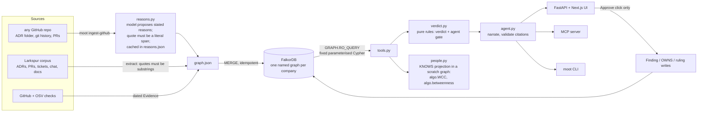

The four outcomes the organisers' reference architecture asks for: `answered_with_path`, `answered_from_memory`, `not_in_graph`, `unknown_entity`. Nothing is written to the graph without an approval call.

How a stated reason gets into the graph:

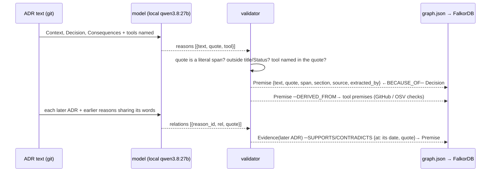

## Graph model

One named graph per company (`select_graph(tenant)`): `gh_kubernetes_enhancements` (Kubernetes, the hosted app's default), `larkspur` (the demo company), `public_adrs` (real ADRs), `backtest` (30 real repositories), and one `gh_<owner>_<repo>` graph per repository brought in with `moot ingest-github`. All of them are selectable in the UI (the Graph menu), the API (`?graph=`) and the MCP audit, gate, ledger and people tools (`graph=`).

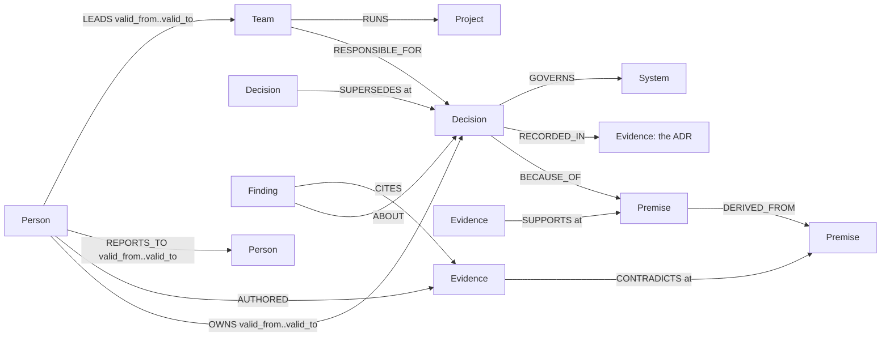

| Label | Key properties | Meaning |
|---|---|---|
| `Decision` | id, title, summary, decided_on, source | a standing decision (one per ADR) |
| `Premise` | id, text, kind (stated / unwritten), unchecked; for a stated reason: quote, span, section, source, extracted_by | a reason behind one or more decisions |
| `Evidence` | id, kind (adr / pr / ticket / chat / doc / check), title, date, excerpt | a dated document |
| `Person` | id, name, role, joined, left | people, with tenure |
| `System` | id, name | what a decision governs |
| `Finding` | id, verdict, kind (verdict / reopen / ruling), as_of, digest | Moot's own memory, written only after a human approves |
| `Team` | id, name, source | a team that answers for decisions (a Kubernetes SIG, a CODEOWNERS team); its leads carry dated windows |
| `Project` | id, name, description | what a team runs (a SIG subproject, a CODEOWNERS path) |

Every event edge (`SUPPORTS`, `CONTRADICTS`, `SUPERSEDES`, `RETIRES`) carries `at`, the date it took effect, and optionally `stated`, the date it became known; an edge a model proposed also carries the exact `quote` and `extracted_by`. Ownership and reporting lines carry validity windows. Indexes: a range index on `id` for every label, full-text on `Decision(title, summary)`, `Premise(text)` and `Evidence(title, excerpt)`. The full edge list is in [docs/queries.md](docs/queries.md).

## The queries and algorithms Moot depends on

The model never writes Cypher. These are the core of the fixed catalogue in `moot/tools.py`; the [full catalogue](docs/queries.md) has all of them.

**The audit**: premises up to `depth` hops, with every dated event known by `as_of`. This query is the verdict.

```cypher
MATCH (d:Decision {id: $id})
MATCH p = (d)-[:BECAUSE_OF|DERIVED_FROM*1..4]->(pr:Premise)
OPTIONAL MATCH (e)-[r:SUPPORTS|CONTRADICTS]->(pr)
  WHERE r.at <= $as_of AND coalesce(r.stated, r.at) <= $as_of
OPTIONAL MATCH (a:Person)-[:AUTHORED]->(e)
RETURN pr, nodes(p) AS pn, length(p) AS hops,
       collect({id: e.id, rel: type(r), at: r.at, quote: r.quote, author: a.name})
ORDER BY hops
```

Pure rules in `moot/verdict.py` then decide: a premise is **expired** when its latest event is a contradiction, **disputed** when contradicted then re-affirmed, **unevidenced** when nothing ever checked it. A decision is **RETIRED** if a dated `SUPERSEDES`/`RETIRES` points at it, **UNDOCUMENTED** with no premise, **MOOT** if any premise within `depth` hops is expired. The **agent gate** audits at depth 6 and answers **ALLOW**, **DENY** or **REVALIDATE** (no evidence is not "holds").

**Who knows why** a decision was made: everyone who owns it, wrote its ADR, or wrote evidence on any reason below it.

```cypher
MATCH (d:Decision {id: $id})
OPTIONAL MATCH (d)-[:BECAUSE_OF|DERIVED_FROM*1..6]->(pr:Premise)<-[:SUPPORTS|CONTRADICTS]-(e:Evidence)<-[:AUTHORED]-(p1:Person)
OPTIONAL MATCH (d)-[:RECORDED_IN]->(:Evidence)<-[:AUTHORED]-(p2:Person)
OPTIONAL MATCH (p3:Person)-[o:OWNS]->(d) WHERE o.valid_from <= $as_of
RETURN collect(DISTINCT p1.id) + collect(DISTINCT p2.id) + collect(DISTINCT p3.id)
```

**What leaves with them**: the who-knows-why rows are written into a scratch graph as `KNOWS` edges between each person still here and each decision they know; the person leaving is removed and `algo.WCC` finds the knowledge islands. An island with decisions and no person left in it is knowledge that walks out of the door. The company graph is never written, and the scratch graph is deleted before the answer returns. (We started with `GRAPH.COPY`; on macOS the embedded server's copy fork can deadlock, so the projection is built from rows.)

```cypher
CALL algo.WCC({nodeLabels: ['Person','Decision'], relationshipTypes: ['KNOWS','KNOWN_BY']}) YIELD node, componentId
RETURN componentId, collect(CASE WHEN node:Decision THEN node.id END), collect(CASE WHEN node:Person THEN node.id END)
```

**Bridges between people**: `algo.betweenness` on the same projection ranks the people through whom most knowledge runs. Its scores are not NetworkX's exact Brandes values on this projection, but the people come out in the same order, which is what Moot reports (`tests/test_algorithms.py` cross-checks WCC, betweenness ranks, PageRank's top premises and SPpaths lengths against NetworkX). **Single points of failure**: reasons that two or more live decisions rest on, vouched for by one document or one person still here.

**Blast radius of a reason**: every decision that rests on it, directly or through derived reasons, plus `algo.pageRank` over the dependency graph for comparison.

```cypher
MATCH (pr:Premise {id: $id})
MATCH p = (d:Decision)-[:BECAUSE_OF|DERIVED_FROM*1..6]->(pr)
RETURN DISTINCT d.id, d.title, length(p)
```

**What did this PR break?** `algo.SPpaths` from a new document to every decision it can reach.

```cypher
MATCH (e:Evidence {id: $id}), (d:Decision)
CALL algo.SPpaths({sourceNode: e, targetNode: d,
     relTypes: ['CONTRADICTS','SUPPORTS','BECAUSE_OF','DERIVED_FROM'], relDirection: 'both', maxLen: 6, pathCount: 1})
YIELD path RETURN d.id, length(path), nodes(path)
```

**Orphaned decisions**: walk `REPORTS_TO` as it stood the day the owner left, skipping managers who also left.

```cypher
MATCH path = (o:Person {id: $pid})-[:REPORTS_TO*1..5]->(m:Person)
WHERE all(r IN relationships(path) WHERE r.valid_from <= $left_on AND (r.valid_to = '' OR r.valid_to > $left_on))
  AND (m.left = '' OR m.left > $as_of)
RETURN m.id, m.name, length(path) ORDER BY length(path) LIMIT 1
```

Read-only is enforced by the engine: every read is `GRAPH.RO_QUERY`, which FalkorDB refuses to run a write through. The UI's **Cypher** tab shows the exact queries each answer ran, with row counts and milliseconds.

## Run it

One command, with Docker (FalkorDB + Moot, seeded on start):

```bash
docker compose up --build     # http://localhost:8000
```

Or locally without Docker (FalkorDB embedded through `falkordblite`, Node 20+ for the UI):

```bash
pip install -e ".[dev]" && make demo     # db + seed + ui + serve on http://localhost:8000
```

Then:

```bash
moot ask "why do we cap uploads" --depth 1 --as-of 2025-06-01
moot ledger                              # every decision with its verdict, MOOT first
moot departure marcus                    # what leaves with a person
moot people                              # who only knows what: bus factor and betweenness per person
moot ingest-github thomvaill/log4brains  # any public repo's ADRs, history and PRs into graph gh_thomvaill_log4brains, audited
moot ingest-keps --sig sig-auth          # Kubernetes KEPs, SIG teams and leads into graph gh_kubernetes_enhancements
moot gate-paths services/uploads/a.py    # gate every decision governing these files (.moot/paths.json); exit 1 on DENY
moot hook                                # Claude Code PreToolUse hook (docs/agents.md)
moot draft-pr thomvaill/log4brains <id>  # the patch + PR body that re-opens a MOOT decision; nothing is pushed
make judge-check                         # tests, every README number re-derived, the held-out gold hash
moot packet D01                          # the evidence packet behind one verdict, as Markdown
moot verify                              # every number in this README checked against the eval JSON, charts included
moot mcp                                 # MCP server on stdio (Claude Desktop, Claude Code, Cursor)
make test                                # pytest; CI runs it and moot verify --rerun against FalkorDB v4.22 and v4.18
```

`ingest-github` reads stated reasons with a local model through [Ollama](https://ollama.com) (`qwen3.8:27b` by default; `MOOT_REASONS_BACKEND=groq` with a `GROQ_API_KEY` instead) and caches every reply; without a model it reads the cache and leaves unread ADRs UNDOCUMENTED. `python3 eval/eval_reasons.py --cached` rebuilds the before/after table, `python3 eval/charts.py` the charts, `node eval/screens.mjs` the screenshots.

**MCP**: `claude mcp add moot -- python3 -m moot.cli mcp`, or `{"mcpServers": {"moot": {"command": "python3", "args": ["-m", "moot.cli", "mcp"], "cwd": "/path/to/moot"}}}` for Claude Desktop and Cursor. The agent's first call is `check_action`; [docs/mcp.md](docs/mcp.md) lists every tool. `GROQ_API_KEY` in `.env` turns on the live model (`moot/llm.py`, `openai/gpt-oss-120b` by default, `ANTHROPIC_API_KEY` as the alternative): it picks the answer tool by tool call and narrates, under a daily spend cap (`MOOT_LLM_DAILY_USD`, default $1), and falls back to the keyword rules and templates when it is off, over the cap or wrong. On 22 ordinary questions the keyword rules misroute it routes 20 correctly ([router eval](eval/results_router.md)). Verdicts never need it.

## Honest limits

- **Moot does not forecast which decisions die.** On held-out real decisions graded by their own repositories it does worse than calling everything HOLDS (52 against 59 of 64), and its flags on real history are confirmed at chance (1 of 12). Outside evidence about a tool (a licence change, a quiet upstream) rarely makes a team abandon a decision within three years. What Moot gives a team is the reason, the path, the date and who to ask, not a prediction.
- **The gate blocks a lot.** With no dated evidence either way it says REVALIDATE: on H1 that is every decision that held. The cost is real; each block names who to ask, and a team's own documents (rulings, later ADRs) are what turns REVALIDATE into ALLOW.
- **Larkspur is synthetic**, and its answer key comes from the same spec as its graph, so on Larkspur the zeros show the rules agree with the spec, not that extraction is solved. The backtest is the result graded by strangers: 722 real decisions, labelled by their own maintainers' status changes. Its six tool deaths are too few to rank anything on recall, and we say so.
- **Moot only knows what was written down.** Three in four real decisions that teams abandoned picked no outside tool, so no outside check could have seen them die. Only a company's own documents can.
- **The gate follows the edges it is given.** The ablation shows random junk contradictions are followed like real ones, which is why every DENY names the evidence id for a human to check.
- **No evidence is not "holds".** A reason nobody ever checked makes the gate say REVALIDATE, which costs six false blocks on Larkspur. We chose that over letting an agent act on an unchecked reason.
- **A stated reason is what the ADR says, not what is true.** Reading reasons from prose moves decisions from UNDOCUMENTED to HOLDS, but most of those reasons have no dated evidence either way, so the gate still says REVALIDATE. The span check stops invented quotes, not a wrong reading of a real one; every reason links to its sentence so a reader can check it. One local model, one run, no labelled set of real reasons to score extraction against.
- **The GitHub connector reads what repositories publish.** It parses status lines and "superseded by" links, picks tools by name from the ADR title or a quoted reason, and checks maintenance, licence and known vulnerabilities. A status change is dated by the last commit to the file, never earlier than the change.
- **Knowing is read from authorship.** A person who knows why but never wrote anything down does not count; the public repositories' people are their git authors, and Kubernetes' are the authors and approvers each KEP names. Team leadership windows are dated to the quarter (`sigs.yaml` sampled at each quarter's first commit).
- **The Kubernetes graph covers SIG Auth** (and SIG Node when its reasons are read), not the whole project, and few later KEPs speak to earlier reasons, so most KEPs hold for want of contradiction and the gate says REVALIDATE.
- The full-text resolver is keyword-based: a question that shares no words with a decision returns "unknown entity", by design.

## AI disclosure

Built with Claude (Claude Code) as a pair programmer under the author's direction: the graph model, verdict rules, query design and corpus spec were specified by the author; Claude wrote most of the code, the synthetic documents and this README from those specifications, and the author reviewed and tested every piece. Inside the product, a model narrates answers and proposes extractions: stated reasons in real ADRs are read by a local open-weights model (`qwen3.8:27b` through Ollama), and the S3 retrieval arms use the same model. It never decides a verdict, never writes Cypher and never touches the database; every quote it proposes is kept only if it is a literal span of the source. Rulings, findings and handovers are written by fixed queries after a human approves, never by the model.

## License

MIT.
