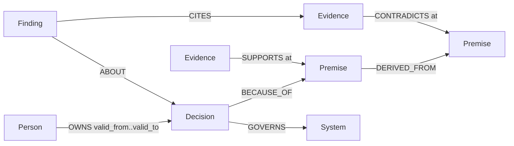

# Moot

**Find the decisions your team still follows for reasons that no longer exist.**

Moot is a company brain that does not answer "what do we do?" It answers "which of our standing decisions still hold, which rest on a premise that has since stopped being true, and where is the evidence?" Decisions, their premises and dated evidence live in a FalkorDB graph. Verdicts are path queries. The model only narrates, and every citation it writes is checked against the rows.

Built for [Graph Hacks: Context for AI Agents](https://www.wemakedevs.org/hackathons/falkordb) (WeMakeDevs x FalkorDB, Oct 2026). Track: **Company Brain**.


## Submission checklist

- [x] FalkorDB is the primary database and the product stops working without it: every verdict is a `ro_query` path query ([graph model](#graph-model), [queries](#the-queries-moot-depends-on))
- [x] Data is synthetic: a fictional 30-person company, Larkspur, with 30 decisions and 207 documents ([data/corpus](data/corpus))
- [x] README has setup steps and the graph data model
- [x] README lists the Cypher queries and graph algorithms the product depends on
- [ ] Demo video (link below when recorded)
- [ ] Live deployment (link below), full local setup is in [Run it](#run-it)
- [x] AI use disclosed ([below](#ai-disclosure))

## What a judge sees in 40 seconds

1. Ask **"Why do we cap uploads at 10 MB?"** Moot answers **MOOT**: the decision rests on "all uploads pass through the API gateway", which rests on "the gateway enforces a 10 MB body limit", which PR-412 contradicted on 2026-03-02 when the limit went to 100 MB. The owner, Ada, left in May. Two more decisions rest on the same dead premise.
2. Flip **depth 1 → 4**. At depth 1 the verdict is HOLDS, because the direct premise is intact. At depth 2 the chain reaches the dead premise. A doc-chat brain stops at depth 1.
3. Set **as of 2025-06-01**. The same question now answers HOLDS, because the contradicting PR does not exist yet.
4. Ask **"Why do we use Postgres for everything?"** → **UNDOCUMENTED**: the ADR states no premise, so there is nothing to check. Ask "why is the sky blue" → **not in the graph**.
5. Click **Approve and record**. Only now does Moot write: a `Finding` node with the verdict, the date and the evidence it cites. Ask again and the outcome is *answered from memory*.

## Run it

Local, no Docker (FalkorDB embedded via `falkordblite`):

```bash
git clone https://github.com/danielAsaboro/moot && cd moot
pip install -e ".[dev]"
make db        # starts FalkorDB on :6379 from the falkordblite package
make seed      # idempotent MERGE of data/graph.json into the "larkspur" graph
make serve     # http://localhost:8000
```

Docker (FalkorDB server + Moot):

```bash
docker compose up --build     # app on :8000, FalkorDB Browser on :3000
```

Optional: `ANTHROPIC_API_KEY` in `.env` turns on model narration, LLM extraction and the end-to-end eval. Verdicts never need it.

CLI:

```bash
moot ledger                              # every decision with its verdict, MOOT first
moot ask "why do we freeze deploys on fridays"
moot ask "why do we cap uploads" --depth 1 --as-of 2025-06-01
moot audit D01                           # the raw rows
moot mcp                                 # MCP server on stdio (Claude Desktop, Claude Code, Cursor)
```

MCP config for Claude Desktop or Claude Code:

```json
{"mcpServers": {"moot": {"command": "python3", "args": ["-m", "moot.cli", "mcp"], "cwd": "/path/to/moot"}}}
```

## Graph model

One named graph per company (`select_graph(tenant)`). Nodes:

| Label | Key properties | Meaning |
|---|---|---|
| `Decision` | id, title, summary, decided_on, source | a standing decision (one per ADR) |
| `Premise` | id, text, kind (fact / constraint / assumption) | a stated reason behind one or more decisions |
| `Evidence` | id, kind (adr / pr / ticket / chat / doc), title, date, excerpt | a dated document |
| `Person` | id, name, role, joined, left | people, with tenure |
| `System` | id, name | what a decision governs |
| `Finding` | id, verdict, as_of, depth, created_at, note | Moot's own memory: an approved verdict |

Edges:

```
(Decision)-[:BECAUSE_OF {quote}]->(Premise)          the stated reason
(Premise)-[:DERIVED_FROM]->(Premise)                 a premise that only holds while another does
(Evidence)-[:SUPPORTS {at, quote}]->(Premise)        dated affirmation
(Evidence)-[:CONTRADICTS {at, quote}]->(Premise)     dated contradiction
(Decision)-[:RECORDED_IN]->(Evidence)                the ADR itself
(Person)-[:OWNS {valid_from, valid_to}]->(Decision)  ownership with a validity window
(Person)-[:AUTHORED]->(Evidence)
(Decision)-[:GOVERNS]->(System)
(Decision)-[:SUPERSEDES]->(Decision)
(Finding)-[:ABOUT]->(Decision), (Finding)-[:CITES]->(Evidence), (Finding)-[:SUPERSEDED_BY]->(Finding)
```



Indexes: range index on `id` for every label; full-text on `Decision(title, summary)`, `Premise(text)` and `Evidence(title, excerpt)` for entity resolution.

Verdict rules (pure Python in `moot/verdict.py`, applied to the rows the queries return):

- a premise is **expired** when its latest dated event (≤ as-of) is a CONTRADICTS; **disputed** when it was contradicted and later re-affirmed; **holds** otherwise
- a decision is **RETIRED** if another decision supersedes it; **UNDOCUMENTED** if it has no premise; **MOOT** if any premise within `depth` hops is expired; **DISPUTED** if any is disputed; **HOLDS** otherwise

## The queries Moot depends on

The model never writes Cypher. These six parameterised queries are the whole tool catalogue (`moot/tools.py`), exposed to the agent, the API and the MCP server.

**1. Entity resolution** (full-text index; the question's content words, OR-ed, prefix-matched)

```cypher
CALL db.idx.fulltext.queryNodes('Decision', $q) YIELD node, score
RETURN node.id, node.title, node.summary, node.decided_on, score ORDER BY score DESC LIMIT $limit
```

**2. The audit**: premises up to `depth` hops, with every dated event on each premise. This is the verdict.

```cypher
MATCH (d:Decision {id: $id})
MATCH p = (d)-[:BECAUSE_OF|DERIVED_FROM*1..4]->(pr:Premise)
OPTIONAL MATCH (e:Evidence)-[r:SUPPORTS|CONTRADICTS]->(pr) WHERE r.at <= $as_of
RETURN pr, nodes(p) AS pn, length(p) AS hops,
       collect({id: e.id, title: e.title, kind: e.kind, rel: type(r), at: r.at, quote: r.quote})
ORDER BY hops
```

`nodes(p)` is returned with every answer and drawn in the UI as the path chain. `$as_of` makes the same question answer differently on different dates.

**3. Shared-premise impact** with PageRank over the whole dependency graph, so expired premises rank by what depends on them:

```cypher
MATCH (pr:Premise {id: $id})
MATCH p = (d:Decision)-[:BECAUSE_OF|DERIVED_FROM*1..6]->(pr)
OPTIONAL MATCH (d)-[:GOVERNS]->(s:System)
RETURN DISTINCT d.id, d.title, length(p), collect(DISTINCT s.name)
```
```cypher
CALL algo.pageRank(null, null) YIELD node, score WHERE node:Premise RETURN node.id, score
```

**4. Trace a new document** to every decision it can reach (`algo.SPpaths`): "what did this PR just break in our rulebook?"

```cypher
MATCH (e:Evidence {id: $id}), (d:Decision)
CALL algo.SPpaths({sourceNode: e, targetNode: d,
     relTypes: ['CONTRADICTS','SUPPORTS','BECAUSE_OF','DERIVED_FROM'], relDirection: 'both', maxLen: 6, pathCount: 1})
YIELD path RETURN d.id, d.title, length(path), nodes(path)
```

**5. Ownership as of a date** (validity windows on the edge):

```cypher
MATCH (p:Person)-[o:OWNS]->(d:Decision {id: $id}) RETURN p.id, p.name, p.role, o.valid_from, o.valid_to
```

**6. The ledger**, one pass for every decision:

```cypher
MATCH (d:Decision) OPTIONAL MATCH (n:Decision)-[:SUPERSEDES]->(d)
OPTIONAL MATCH p = (d)-[:BECAUSE_OF|DERIVED_FROM*1..4]->(pr:Premise)
OPTIONAL MATCH (e:Evidence)-[r:SUPPORTS|CONTRADICTS]->(pr) WHERE r.at <= $as_of
WITH d, n, pr, collect({rel: type(r), at: r.at}) AS ev
OPTIONAL MATCH (o:Person)-[w:OWNS]->(d) OPTIONAL MATCH (d)-[:GOVERNS]->(s:System)
RETURN d, n.id, pr.id, ev, o.name, w.valid_to, collect(DISTINCT s.name) ORDER BY d.id
```

**The one write**, behind the approval button: a `Finding` that supersedes the previous finding for the decision and cites the evidence it relied on.

```cypher
MATCH (d:Decision {id: $did})
OPTIONAL MATCH (prev:Finding)-[:ABOUT]->(d) WHERE NOT (prev)-[:SUPERSEDED_BY]->()
WITH d, collect(prev) AS prevs
CREATE (f:Finding {id: $fid, verdict: $verdict, as_of: $as_of, depth: $depth, created_at: $now})-[:ABOUT]->(d)
...  (prev)-[:SUPERSEDED_BY]->(f), (f)-[:CITES]->(e)
```

Also used: `algo.WCC` in tests and exploration to cluster decisions that share premises, and `db.idx.fulltext.createNodeIndex` for the indexes above.

## Architecture

```
corpus (ADRs, PRs, tickets, chat, docs)
   │  moot extract  (model proposes; every quote must be a substring of its document, or it is dropped)
   ▼
truth.json / extracted.json ──► graph.json ──► moot seed (MERGE, idempotent) ──► FalkorDB, one graph per company
                                                                                   │
            ┌───────── six read-only parameterised Cypher tools (ro_query) ────────┘
            ▼
   verdict.py (pure)  ──►  agent.py: resolve → audit → memory check → narrate → validate citations
            │                       │
      FastAPI + web UI        MCP server (stdio)      moot CLI
            │
   Approve ──► write_finding (the only write)
```

Four outcomes, as the organisers' reference architecture asks: `answered_with_path`, `answered_from_memory`, `not_in_graph`, `unknown_entity`.

## Evaluation

`make eval` reproduces [eval/results.md](eval/results.md) with no model: for the 16 decisions that have an invalidating document, does the method surface it?

| method | recall@5 of invalidating docs | decisions with ≥1 found |
|---|---|---|
| graph path query (Moot) | **1.00** | **100%** |
| BM25 top-5, query = decision title + summary | 0.81 | 81% |
| random 5 docs (control) | 0.01 | – |

`make eval-e2e` (needs a key) runs the model-in-the-loop comparison: a BM25 RAG company brain asked "does this still hold?" against Moot's graph verdict, scored on verdict accuracy and whether the cited document is the true invalidating one. Results land in `eval/results_e2e.md`.

## Honest limits

- The corpus is synthetic. Larkspur, its people and its documents are invented; the templated noise documents are generated from a seed. The committed `graph.json` is built from the ground-truth spec, not from the LLM extractor. `moot extract` runs the extractor over the same text so the two can be compared, and its span check drops any premise or relation whose quote is not literally in the source.
- A premise can expire without any document saying so. Moot only knows what was written down.
- Extraction misses premises that are implied rather than stated. Verdicts are only as good as the BECAUSE_OF edges.
- "Disputed" is a coarse rule (contradicted, then re-affirmed). It does not weigh evidence quality.
- BM25 is a fair but not state-of-the-art retrieval baseline; it was chosen so the eval reproduces without an embedding model.
- The full-text resolver is keyword-based. A question that shares no words with a decision's title or summary returns "unknown entity" rather than a guess, by design.

## AI disclosure

Built with Claude (Claude Code) as a pair programmer under the author's direction: the graph model, verdict rules, query design and corpus spec were specified by the author; Claude wrote most of the code, the synthetic documents and this README from those specifications, and the author reviewed and tested every piece. The model inside the product (`claude-opus-5-5` by default) narrates and extracts; it never decides a verdict and never writes Cypher.

## License

MIT.
