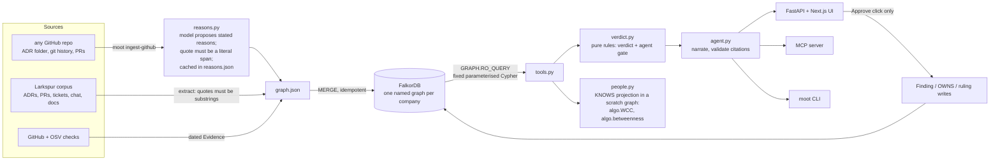
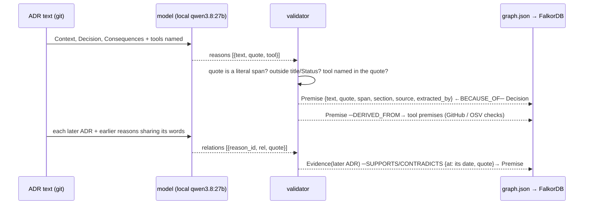
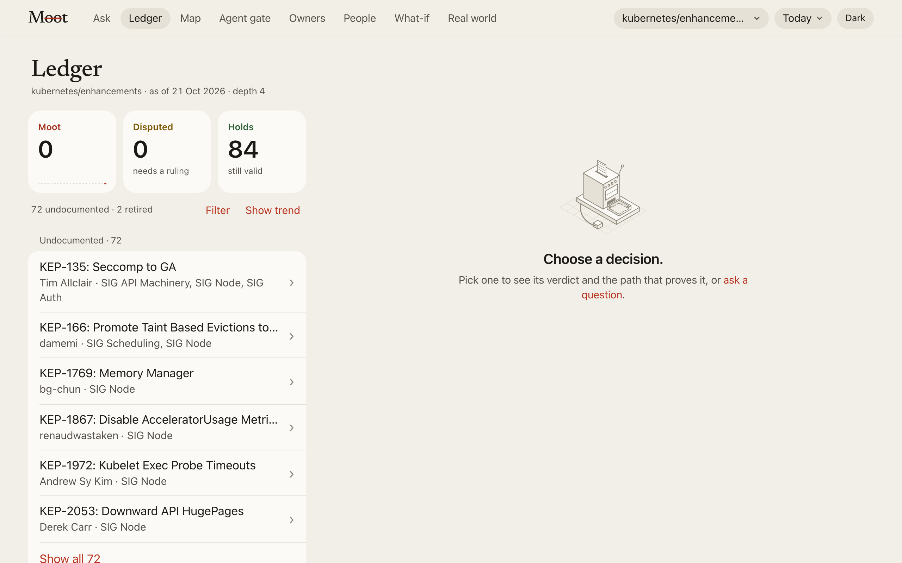
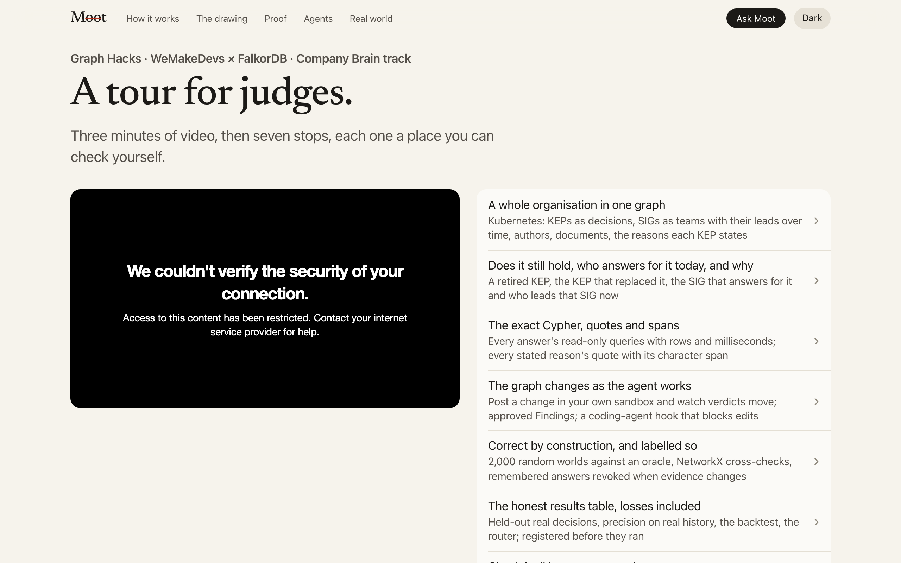

# Architecture and screens

## Architecture

The four outcomes the organisers' reference architecture asks for: `answered_with_path`, `answered_from_memory`, `not_in_graph`, `unknown_entity`. Nothing is written to the graph without an approval call.

How a stated reason gets into the graph:

## Screens

| | |
|---|---|
|  **Evidence path.** Every verdict is drawn from the rows FalkorDB returned: D01, the reason, the expired reason behind it, PR-412. |  **Cypher.** The exact read-only queries each answer ran, with parameters, row counts and milliseconds. |
|  **People.** Who only knows what: bus factor, `algo.WCC` knowledge islands and betweenness on a KNOWS projection. |  **Graph picker.** One named graph per company: Larkspur, real ADRs, the backtest, every ingested repository. |
|  **Stated reasons.** log4brains chose Lerna because "Yarn + Lerna seems to be a very good practice"; its own later ADR says Lerna "does not integrate well". The exact words, the source and the model that read them. |  **Landing.** Straight links to the evidence path, the Cypher, People and an audited repository. |

| | |
|---|---|
|  **Kubernetes.** The ledger of 158 KEPs, by verdict. |  **Tour for judges.** The track, the video and seven places to check. |
