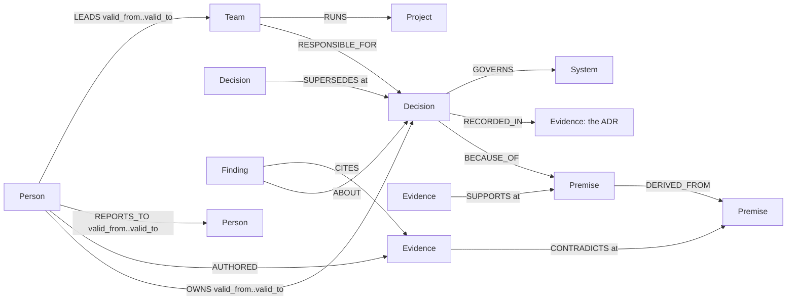

# Guide: running Moot, its queries, and where to look

## Run it

One command, with Docker (FalkorDB + Moot, seeded on start):

```bash
docker compose up --build     # http://localhost:8000
```

Or locally without Docker (FalkorDB embedded through `falkordblite`, Node 20+ for the UI):

```bash
pip install -e ".[dev]" && make demo     # db + seed + ui + serve on http://localhost:8000
```

Then:

```bash
moot ask "why do we cap uploads" --depth 1 --as-of 2025-06-01
moot ledger                              # every decision with its verdict, MOOT first
moot departure marcus                    # what leaves with a person
moot people                              # who only knows what: bus factor and betweenness per person
moot ingest-github thomvaill/log4brains  # any public repo's ADRs, history and PRs into graph gh_thomvaill_log4brains, audited
moot ingest-keps --sig sig-auth          # Kubernetes KEPs, SIG teams and leads into graph gh_kubernetes_enhancements
moot gate-paths services/uploads/a.py    # gate every decision governing these files (.moot/paths.json); exit 1 on DENY
moot hook                                # Claude Code PreToolUse hook (docs/agents.md)
moot draft-pr thomvaill/log4brains <id>  # the patch + PR body that re-opens a MOOT decision; nothing is pushed
make judge-check                         # tests, every README number re-derived, the held-out gold hash
moot packet D01                          # the evidence packet behind one verdict, as Markdown
moot verify                              # every number in this README checked against the eval JSON, charts included
moot mcp                                 # MCP server on stdio (Claude Desktop, Claude Code, Cursor)
make test                                # pytest; CI runs it and moot verify --rerun against FalkorDB v4.22 and v4.18
```

`ingest-github` reads stated reasons with a local model through [Ollama](https://ollama.com) (`qwen3.8:27b` by default; `MOOT_REASONS_BACKEND=groq` with a `GROQ_API_KEY` instead) and caches every reply; without a model it reads the cache and leaves unread ADRs UNDOCUMENTED. `python3 eval/eval_reasons.py --cached` rebuilds the before/after table, `python3 eval/charts.py` the charts, `node eval/screens.mjs` the screenshots.

**MCP**: `claude mcp add moot -- python3 -m moot.cli mcp`, or `{"mcpServers": {"moot": {"command": "python3", "args": ["-m", "moot.cli", "mcp"], "cwd": "/path/to/moot"}}}` for Claude Desktop and Cursor. The agent's first call is `check_action`; [docs/mcp.md](mcp.md) lists every tool. `GROQ_API_KEY` in `.env` turns on the live model (`moot/llm.py`, `openai/gpt-oss-120b` by default, `ANTHROPIC_API_KEY` as the alternative): it picks the answer tool by tool call and narrates, under a daily spend cap (`MOOT_LLM_DAILY_USD`, default $1), and falls back to the keyword rules and templates when it is off, over the cap or wrong. On 22 ordinary questions the keyword rules misroute it routes 20 correctly ([router eval](../eval/results_router.md)). Verdicts never need it.

## The graph model in full

One named graph per company (`select_graph(tenant)`): `gh_kubernetes_enhancements` (Kubernetes, the hosted app's default), `larkspur` (the demo company), `public_adrs` (real ADRs), `backtest` (30 real repositories), and one `gh_<owner>_<repo>` graph per repository brought in with `moot ingest-github`. All of them are selectable in the UI (the Graph menu), the API (`?graph=`) and the MCP audit, gate, ledger and people tools (`graph=`).



| Label | Key properties | Meaning |
|---|---|---|
| `Decision` | id, title, summary, decided_on, source | a standing decision (one per ADR) |
| `Premise` | id, text, kind (stated / unwritten), unchecked; for a stated reason: quote, span, section, source, extracted_by | a reason behind one or more decisions |
| `Evidence` | id, kind (adr / pr / ticket / chat / doc / check), title, date, excerpt | a dated document |
| `Person` | id, name, role, joined, left | people, with tenure |
| `System` | id, name | what a decision governs |
| `Finding` | id, verdict, kind (verdict / reopen / ruling), as_of, digest | Moot's own memory, written only after a human approves |
| `Team` | id, name, source | a team that answers for decisions (a Kubernetes SIG, a CODEOWNERS team); its leads carry dated windows |
| `Project` | id, name, description | what a team runs (a SIG subproject, a CODEOWNERS path) |

Every event edge (`SUPPORTS`, `CONTRADICTS`, `SUPERSEDES`, `RETIRES`) carries `at`, the date it took effect, and optionally `stated`, the date it became known; an edge a model proposed also carries the exact `quote` and `extracted_by`. Ownership and reporting lines carry validity windows. Indexes: a range index on `id` for every label, full-text on `Decision(title, summary)`, `Premise(text)` and `Evidence(title, excerpt)`. The full edge list is in [docs/queries.md](queries.md).

## The queries and algorithms Moot depends on

The model never writes Cypher. These are the core of the fixed catalogue in `moot/tools.py`; the [full catalogue](queries.md) has all of them.

**The audit**: premises up to `depth` hops, with every dated event known by `as_of`. This query is the verdict.

```cypher
MATCH (d:Decision {id: $id})
MATCH p = (d)-[:BECAUSE_OF|DERIVED_FROM*1..4]->(pr:Premise)
OPTIONAL MATCH (e)-[r:SUPPORTS|CONTRADICTS]->(pr)
  WHERE r.at <= $as_of AND coalesce(r.stated, r.at) <= $as_of
OPTIONAL MATCH (a:Person)-[:AUTHORED]->(e)
RETURN pr, nodes(p) AS pn, length(p) AS hops,
       collect({id: e.id, rel: type(r), at: r.at, quote: r.quote, author: a.name})
ORDER BY hops
```

Pure rules in `moot/verdict.py` then decide: a premise is **expired** when its latest event is a contradiction, **disputed** when contradicted then re-affirmed, **unevidenced** when nothing ever checked it. A decision is **RETIRED** if a dated `SUPERSEDES`/`RETIRES` points at it, **UNDOCUMENTED** with no premise, **MOOT** if any premise within `depth` hops is expired. The **agent gate** audits at depth 6 and answers **ALLOW**, **DENY** or **REVALIDATE** (no evidence is not "holds").

**Who knows why** a decision was made: everyone who owns it, wrote its ADR, or wrote evidence on any reason below it.

```cypher
MATCH (d:Decision {id: $id})
OPTIONAL MATCH (d)-[:BECAUSE_OF|DERIVED_FROM*1..6]->(pr:Premise)<-[:SUPPORTS|CONTRADICTS]-(e:Evidence)<-[:AUTHORED]-(p1:Person)
OPTIONAL MATCH (d)-[:RECORDED_IN]->(:Evidence)<-[:AUTHORED]-(p2:Person)
OPTIONAL MATCH (p3:Person)-[o:OWNS]->(d) WHERE o.valid_from <= $as_of
RETURN collect(DISTINCT p1.id) + collect(DISTINCT p2.id) + collect(DISTINCT p3.id)
```

**What leaves with them**: the who-knows-why rows are written into a scratch graph as `KNOWS` edges between each person still here and each decision they know; the person leaving is removed and `algo.WCC` finds the knowledge islands. An island with decisions and no person left in it is knowledge that walks out of the door. The company graph is never written, and the scratch graph is deleted before the answer returns. (We started with `GRAPH.COPY`; on macOS the embedded server's copy fork can deadlock, so the projection is built from rows.)

```cypher
CALL algo.WCC({nodeLabels: ['Person','Decision'], relationshipTypes: ['KNOWS','KNOWN_BY']}) YIELD node, componentId
RETURN componentId, collect(CASE WHEN node:Decision THEN node.id END), collect(CASE WHEN node:Person THEN node.id END)
```

**Bridges between people**: `algo.betweenness` on the same projection ranks the people through whom most knowledge runs. Its scores are not NetworkX's exact Brandes values on this projection, but the people come out in the same order, which is what Moot reports (`tests/test_algorithms.py` cross-checks WCC, betweenness ranks, PageRank's top premises and SPpaths lengths against NetworkX). **Single points of failure**: reasons that two or more live decisions rest on, vouched for by one document or one person still here.

**Blast radius of a reason**: every decision that rests on it, directly or through derived reasons, plus `algo.pageRank` over the dependency graph for comparison.

```cypher
MATCH (pr:Premise {id: $id})
MATCH p = (d:Decision)-[:BECAUSE_OF|DERIVED_FROM*1..6]->(pr)
RETURN DISTINCT d.id, d.title, length(p)
```

**What did this PR break?** `algo.SPpaths` from a new document to every decision it can reach.

```cypher
MATCH (e:Evidence {id: $id}), (d:Decision)
CALL algo.SPpaths({sourceNode: e, targetNode: d,
     relTypes: ['CONTRADICTS','SUPPORTS','BECAUSE_OF','DERIVED_FROM'], relDirection: 'both', maxLen: 6, pathCount: 1})
YIELD path RETURN d.id, length(path), nodes(path)
```

**Orphaned decisions**: walk `REPORTS_TO` as it stood the day the owner left, skipping managers who also left.

```cypher
MATCH path = (o:Person {id: $pid})-[:REPORTS_TO*1..5]->(m:Person)
WHERE all(r IN relationships(path) WHERE r.valid_from <= $left_on AND (r.valid_to = '' OR r.valid_to > $left_on))
  AND (m.left = '' OR m.left > $as_of)
RETURN m.id, m.name, length(path) ORDER BY length(path) LIMIT 1
```

Read-only is enforced by the engine: every read is `GRAPH.RO_QUERY`, which FalkorDB refuses to run a write through. The UI's **Cypher** tab shows the exact queries each answer ran, with row counts and milliseconds.

## Judging criteria: where to look

| criterion | the evidence |
|---|---|
| **Graph-native use of FalkorDB** | Verdicts *are* path queries over dated edges, all through `GRAPH.RO_QUERY` ([queries](queries.md)); `algo.WCC`, `algo.betweenness`, `algo.pageRank`, `algo.SPpaths` answer who knows why, what leaves with a person, blast radius and what a PR broke; one named graph per organisation. Removing FalkorDB but keeping the rules drops Larkspur's head-to-head from 90/90 to 60/90 and H1 from 52/64 to 24/64. |
| **Agent effectiveness** | On K2, the registered confirmation, the same model with Moot's graph tools answers 41 of 57 Kubernetes questions against 22 with file and git tools (exact McNemar p < 0.001) and 26 for BM25 RAG, at a quarter of the file agent's tokens and time; on K1 it was level with the file agent (26 against 22 of 34). The gate answers before an agent acts, names who to ask, and blocks a coding agent's edit under a dead decision. On real decisions the old strict policy blocked everything it could not vouch for (59 of 59 that held); the product policy lets 4 of 5 later-dead decisions through but blocks only 8 of 59 that held. A tool-call router routes 20 of 22 questions the keyword rules misroute. |
| **Potential impact** | A real organisation end to end (Kubernetes), any public repository's ADRs and CODEOWNERS, and an agent gate that works over HTTP, MCP and in the editor. |
| **Technical excellence** | One-command setup (`docker compose up --build`, or `make demo`), 187 tests, CI on FalkorDB v4.22.1 and v4.18.3 plus the UI build, `moot verify --rerun` re-derives every number above from committed inputs, `make judge-check` runs it all. |
| **Explainability and provenance** | Every answer carries its path, evidence ids and dates, the Cypher it ran and a digest of the rows; every model-proposed quote is a checked literal span with its source and model. "No evidence" is never "holds". |
| **Creativity and presentation** | A brain that refuses: MOOT, DENY or "not in the graph" instead of an answer; isometric drawings of the real rows, the ruled ledger, the [video](https://vimeo.com/1237038749) and the [blog](https://moot.bringaihome.xyz/i-built-a-company-brain-that-refuses-to-answer-questions/). |
